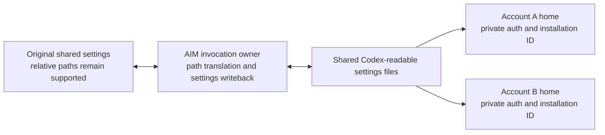

# Codex privacy through AI Manager: privacy first, optional proxies second

Created November 1, 2026. Revised November 4, 2026 against AIM `60a7204`, the completed Claude work and its subsequent workflow corrections. **Milestone 1 is in implementation. Per-account and per-environment isolation comes first, with shared settings adapted by AIM and optional proxies in milestone 2.** Section 4.3 specifies how relative paths and native settings edits work with unmodified Codex. Section 4.4 includes Amir's subsequently added environment-local authentication requirement; the earlier cold architecture/test-plan approval does not certify this amendment or the implementation. This is the canonical plan; section 10 records the earlier review and the distinction between design evidence and implementation acceptance.

| Milestone | Result | Dependency |
| --- | --- | --- |
| **1. Privacy protections** | AIM starts approved vanilla Codex with private account identity, vendor-only file/device restrictions, optional provider telemetry disabled, remote control disabled and no persistent shared Codex daemon. Ordinary tools retain normal host access. | Local approved runtime and privacy policy. No proxy, routing service, Chrome binding or external IP check is required for an ordinary launch. |
| **2. Optional proxy support** | An enrolled account's native Codex traffic and AIM's OpenAI requests use its assigned route, including authentication and failure recovery. | Milestone 1 plus the existing account-specific proxy infrastructure. Accounts without assignments retain milestone 1. |

Milestone 1 protects against **automatic collection by the vendor client**. It does not hide the public source IP; milestone 2 adds that. Neither milestone redacts work the user asks the agent to read, hides the account from its provider, or prevents correlation through shared task content. A proxy cannot remove metadata inside HTTPS requests.

The implementation must preserve current native development, settings, credentials, history, concurrent sessions, skills, MCP and scheduled work. A passing isolated privacy test cannot excuse breaking an ordinary workflow. Amir permits path-setting changes to wait for a new session and explicitly requires relative shared paths to remain supported. Account-directory isolation is a firm requirement; it is not deferred to proxy work or traded away for easier configuration handling.

**Approved gap — organization-managed policies (November 4).** Amir explicitly accepted: “you can mark organization owned policies an approved gap. I just won't do that. Proceed. No changes to codex for this one.” The privacy guarantees exclude organization-supplied remote requirements and transitions into that policy regime, including a transition after native auth refresh. Local directory isolation, environment-local primary credentials, ordinary local policy enforcement and independent-tool compatibility remain required. Keep official unmodified Codex. Do not add a fork, remote-policy interception, periodic account policing or account-tier ban to close this accepted gap. Local installer/MDM privacy conflicts still receive concrete admission errors. This exception narrows the policy guarantee; it does not claim that a personal-plan snapshot proves session-lifetime policy eligibility.

**Approved diagnostic exporter removal (November 4).** Amir approved disabling all optional Codex diagnostic exporters, including independent user-owned collectors, after the native live-edit/auth-refresh test reproduced a provider-destination leak. Enforce `otel.exporter`, `otel.trace_exporter` and `otel.metrics_exporter` as `"none"` in native requirements, including reload. This replaces the earlier independent-collector compatibility promise; it does not disable model requests, ordinary tools or their SDK integrations.

**Approved Linux mount-information exception (November 4).** Amir approved allowing native Codex to read filesystem mount information to preserve its original read-only reviewers. The exact permission is `owner /proc/[0-9]*/mountinfo r`: it includes same-user processes' mount tables, not only the current process. Mount paths, device/source names, filesystem types and options can disclose user or network-share names. The inspected native sandbox builder uses the table locally to mask privileged socket aliases; transmission of that table was not found. Grant only the fixed UID daemon directory itself, without descendants, alongside that mount-table read. All other file and identifier restrictions remain enforced. Exact image reentry retains both the tools and vendor AppArmor profiles under `no_new_privs`, and any vendor component still denies uname.

The native Linux workspace sandbox also needs to create and remove its empty metadata mask directories at `/tmp/.git`, `/tmp/.agents`, `/tmp/.codex` and `/tmp/.aws`. Grant same-user directory-entry writes only (`owner /tmp/.{git,agents,codex,aws}/ w,`), with no listing or descendant access. Native preserves pre-existing inode identities; a pre-existing canary file must remain unreadable and unmodifiable. This restores unchanged native `/tmp` tool behavior without adding a general vendor read or write grant there.

**Approved Mac Keychain exception (November 5 UTC).** Amir explicitly approved: “Yes—allow the Keychain exception.” Native MCP requires filesystem reads and writes to the selected User-domain default Keychain database, its exact native lock file and that database's atomic replacement files. This exposes unrelated account and service names in the database and permits modification of the database file as a whole; native password encryption and item permissions remain. The permission is not confined to MCP records. Discover the selected default through Security.framework without changing it, unlocking it or prompting. Grant only the canonical selected database, its SHA-1-derived `.fl` lock and anchored, escaped `<database>.sb-<nonce>` paths. Retain denial of database extended-attribute reads and parent-directory listing. Exact security preferences and required discovery metadata remain readable. This does not permit a Keychains-directory grant, unrelated databases, primary-auth transfer or changes to official Codex.

**Exact implementation release.** Pair the unchanged official Codex 0.166.0 executables with the helper built from that release’s source commit `6ff1e1ca3b30fc8b914720681fcf5fe62e95f856`. Verify published asset digests and the pinned source archive; a development checkout’s embedded version does not identify an official release. The previous exploratory alpha.5 package/newer-source pairing is not acceptance evidence for this exact pair. Rerun the native acceptance matrix after correcting it.

## 1. Requirements, assumptions, and exclusions

These requirements apply to AIM-managed **Codex CLI** entry points, including scheduled `exec`, resume/fork, required invocation-owned stdio app-server, and AIM's own auth/refresh/usage requests. This does not redesign Pi, Prime, OpenClaw or the desktop application. Shared helpers must retain their existing behavior for those callers.

| Required behavior | Milestone |
| --- | --- |
| Execute official, unmodified, explicitly approved complete Codex artifact sets. No fork, vendor re-signing, injected library, custom-provider impersonation or production TLS interception. | 1 |
| Restrict Codex's automatic access to unrelated personal files, other accounts, host identifiers, exact OS version and terminal-version details. Apply the boundary before vendor initialization and to every retained vendor helper. | 1 |
| Keep account credentials and installation identity private to the underlying account **and environment**, with stable continuity inside that environment and no shared-home launch race. Never transfer `auth.json` or its equivalent primary tokens between machines/environments, including through Redis, caches, backups used for bootstrap, or account import/export. | 1 |
| Disable optional analytics, diagnostic/feedback exporters and remote-control enrollment/relay, including saved enabled state and automatic reentry. The approved removal includes independent Codex diagnostic collectors. | 1 |
| Select standalone TUI, native `exec` and only necessary invocation-owned local backends. Never start or attach to the persistent shared daemon or its updater. | 1 |
| Retain the existing manual-callback OAuth protocol and healthy refresh; remove AIM's unused automatic/native/device-login alternatives without changing browser identity. | 1 |
| Preserve models, explicit model versions, reasoning effort, permissions, cwd, live worktrees, normal terminal use, instructions, memory, history, skills, MCP authentication and packages, subagents, nested agents, concurrency and schedules. | Both |
| Permit ordinary tools to use normal host APIs, files, credentials and their own sandbox. Do not enforce the vendor privacy policy against arbitrary tool code. | Both |
| Keep proxy enrollment optional and bind an enrolled account to one assigned route. A missing route never downgrades it to ordinary networking. | 2 |
| Carry native HTTP/WebSocket/auth traffic and AIM HTTP requests through that route. Preserve the original local browser and its existing assigned proxy from the first sign-in request. | 2 |
| Retain safe same-route recovery from brief connectivity failures; never fall back to direct traffic, rotate routes/accounts, resume a failed invocation or replay an interrupted scheduled occurrence automatically. | 2 |

**Accepted scope.** Keep ordinary model/task content, including source, paths, Git context, instructions, history, tool results and user-requested host inspection. Broad OS family and architecture are the accepted Claude baseline to carry forward; exact versions, hostname, hardware UUID/serial and unrelated persistent identifiers are different targets. Provider/account IDs, client version and valid session/thread IDs remain functional protocol data. Their presence is not a failed telemetry test. Existing browser cookies and its ordinary fingerprint remain unchanged.

Malicious tools, deliberate credential theft, privileged tampering and deliberate execution outside AIM remain accepted risks. Independent services such as GitHub, Figma, Redis and registries remain usable. A collector acting for OpenAI is still in scope even if another company operates it. These exceptions do not excuse an automatic vendor subprocess collecting identifiers through a shell.

Earlier explicit Codex decisions remain: telemetry off for all Codex sessions on configured machines; manual callback only; no persistent shared daemon; exact-build approval. Terminal extras, realtime/voice, optional personal hooks and unrelated plugin features are not required. Their exclusion **does not authorize disabling infrastructure used by skills/MCP, changing permission modes, or breaking tools such as Chrome**. Do not transfer Claude's individual-Pro/Max account restriction to Codex. Retain currently supported account classes; organization-managed remote policy is the explicit approved gap above, not a new account-tier restriction.

The existing `resume-fresh`/`cr` rule remains: rotating continuation creates fresh thread/session identities. Explicit manual same-thread cross-account resume retains its warning. Do not restore `crr`, reuse an old thread ID automatically under another account, or promise content unlinkability.

## 2. Claude lessons that change this design

The [Claude workflow impact review](CLAUDE_PRIVACY_WORKFLOW_IMPACT_2026-11-03.md) records the failures. The [tool restriction rollback](CLAUDE_TOOL_RESTRICTIONS_ROLLBACK_2026-11-03.md) and current source take precedence over older statements in the Claude implementation plan.

| What went wrong or changed | Codex design rule | Required regression |
| --- | --- | --- |
| Ordinary children inherited vendor restrictions. Chrome could not establish its sandbox; nested agents failed or changed their review workflow. | Apply privacy restrictions to reviewed vendor images. Ordinary executable children leave that policy. Reuse the corrected general transition, not a growing executable allowlist. | A protected Codex launches shell, Chrome with its stock sandbox, a sandboxed Codex reviewer and same/different-account AIM Claude/Codex children. Each performs real work. |
| A reboot changed device numbers on old launch receipts. Optional cleanup blocked otherwise valid resumes. | Preserve uncertain old files and continue. Cleanup is best effort; validating the current executable/account/privacy inputs is mandatory. Never delete a different inode to make cleanup pass. | Old device IDs, stale receipts and permission-denied cleanup cannot block unrelated new launches or resumes. |
| Startup checks inspected updater parent paths hidden by an inherited sandbox. | Ordinary nested tools have their normal filesystem view; validate only the actual selected runtime and necessary launch inputs. | Nested launch works without another session relaying commands or changing environment paths. |
| A mutable command link drifted from the approved runtime. | Normal AIM launch selects the installed approved immutable artifact directly. PATH discovery is for inspection or an explicit requested artifact, not a second selector after admission. | Changing an unrelated vendor symlink cannot interrupt healthy approved sessions or redirect normal AIM launches. An explicitly requested unknown artifact is refused. |
| The account picker selected accounts the Claude runtime could not admit. | Selection and admission use the same supported Codex policy facts. Do not add a subscription-name ban copied from Claude. | Every automatic selection can enter the selected runtime; explicit existing-account resume retains supported behavior. |
| Extra proxy checks killed sessions on transient connectivity failures and added process-startup load. | Milestone 1 has no route probe or proxy monitor. Milestone 2 reuses the current bounded recovery policy and cheap native probe. | No route dependencies in milestone 1; brief route failures retain sessions, fatal identity/owner failures close admission. |
| Optional detached conversations introduced a reused vendor owner outside the admitted build. | Keep Codex's already-approved standalone choice. A shared daemon ban is not a ban on ordinary background Bash, subagents or independent AIM jobs. | No persistent Codex daemon/update owner; required live-session background work still succeeds. |
| Agents worked around failures by changing models, disabling a reviewer sandbox or pasting entire files into prompts. | Such a workaround is a failed compatibility test, even if the final task eventually succeeds. | Fixtures assert the original command, permission mode, tool and intended result. |

Code anchors: [ordinary Mac tool transition](../../native/claude/approved_launch_macos.c), [Linux vendor/tool transitions](../../native/claude/approved_launch_linux.c), [nonblocking launch-file retention](../../src/privacy/claude-launch-retention.js), [routine reboot recovery](../../src/routines/run.js), and [current proxy recovery](../../native/claude/darwin_proxy.py). The Mac correction was commit `3db9228`; cleanup correction was `b2c3d56`; reboot lock recovery was `5505c46`.

Do not add a global process registry, persistent settings service, custom filesystem, credential broker, per-tool permission list, desktop replacement, development VM, blanket background-task ban, per-session approval prompt or OS-release allowlist. The settings adapter in section 4.3 runs inside AIM's existing invocation owner. Required build approval covers the vendor artifact and its compatible privacy bundle, not macOS patch numbers or unrelated compilers.

## 3. Source baseline and what is actually established

AIM baseline: `60a7204`. Upstream source baseline remains official Codex [`54201ea65a3501d09a87c776376a0c16aa39db70`](https://github.com/openai/codex/tree/54201ea65a3501d09a87c776376a0c16aa39db70), inspected locally without running Codex. Historical offsite runtime evidence used official `0.163.0-alpha.5`. Source HEAD, installed binaries, tested packages and approved packages are separate facts. The first implementation task records the exact candidate package and source mapping; this plan does not approve a build.

| Established finding | Design consequence |
| --- | --- |
| Native HTTP and model WebSocket User-Agent include OS/version/architecture and detected terminal; analytics opt-out does not remove them. | Enforce compatible vendor-only metadata restrictions and capture both transports. Header settings on the built-in provider are not a substitute. |
| `installation_id` is transmitted in functional requests and cached per request owner. AIM currently writes a label-derived ID and auth into a shared managed home. | Bind a private account home before projection and spawn. Do not release selection and then rediscover another account's home. |
| Remote-control enrollment sends hostname and installation identity; saved state can enable a relay. | Enforce `allow_remote_control = false` in native requirements before startup; do not merely clear one preference. |
| macOS doctor reads the desktop bootstrap installation ID outside `CODEX_HOME`. A narrow read denial suppressed the synthetic ID while preserving the observed CDN fallback. | Keep the exact file denial; test full diagnostics on the selected build. Never edit the real desktop identity. |
| Blanket host-information denial killed the researched clients. Targeted Mac restrictions removed exact OS versions in captured requests. | Use the narrow tested primitives, not a blanket syscall deny policy or OS spoofing through PATH. |
| Separate homes change relative config roots and encrypted-secret key lookup. | Account directories alone are not a migration. Section 4.3 and 4.4 define required treatment. |
| The complete official package needs `codex-code-mode-host` for the tested model's tools. | Approve and contain the complete vendor package; this helper is not an independent shell tool. |
| Standalone skills/MCP, concurrent TUIs, subagents, resume/fork and a scheduled adapter worked in bounded offsite fixtures. Fresh concurrent SQLite migration raced. | Reuse those fixtures and a bounded first-migration lock; no lifetime session mutex. |
| A Mac heartbeat shell child survived owner SIGKILL in research. | Determine whether it is an ordinary requested tool or a vendor request owner. Its survival alone does not authorize killing all background tools or building another daemon. |

Evidence: [identifier audit](PRIVACY_STATE_AUDIT_2026-11-01.md), [native feasibility tests](PRIVACY_SANDBOX_FEASIBILITY_2026-11-01.md), [standalone workflow results](PRIVACY_STANDALONE_TESTS_2026-11-01.md). These are bounded research findings, not passes for the new implementation matrix.

Primary source anchors: [native User-Agent](https://github.com/openai/codex/blob/54201ea65a3501d09a87c776376a0c16aa39db70/codex-rs/login/src/auth/default_client.rs), [terminal detection](https://github.com/openai/codex/blob/54201ea65a3501d09a87c776376a0c16aa39db70/codex-rs/terminal-detection/src/lib.rs), [functional metadata](https://github.com/openai/codex/blob/54201ea65a3501d09a87c776376a0c16aa39db70/codex-rs/core/src/responses_metadata.rs), [config origins](https://github.com/openai/codex/blob/54201ea65a3501d09a87c776376a0c16aa39db70/codex-rs/config/src/loader/mod.rs), [config reload](https://github.com/openai/codex/blob/54201ea65a3501d09a87c776376a0c16aa39db70/codex-rs/app-server/src/config_manager.rs), [encrypted namespaces](https://github.com/openai/codex/blob/54201ea65a3501d09a87c776376a0c16aa39db70/codex-rs/secrets/src/local.rs), [key derivation](https://github.com/openai/codex/blob/54201ea65a3501d09a87c776376a0c16aa39db70/codex-rs/secrets/src/lib.rs).

The [official configuration reference](https://learn.chatgpt.com/docs/config-file/config-reference) and [advanced configuration guide](https://learn.chatgpt.com/docs/config-file/config-advanced), checked November 3, document separate user/project/profile layers and their path contexts. They do not establish an arbitrary public user-config-file selector. The pinned loader's `LoaderOverrides.user_config_path` is an internal Rust interface; a design must not invent a corresponding CLI flag.

## 4. Milestone 1 implementation design

### 4.1 One prepared launch, independent of routing

The existing command owner selects an account once and prepares a launch value containing provider, label, verified underlying account ID, local environment identity, environment-bound credential generation, private state root, canonical shared-state sources, approved artifact identity, applicable privacy policy and optional route assignment. Pass that value to the interactive runner, scheduled `exec`, resume/fresh continuation and owned app-server. Do not rediscover the account from shared active state after releasing the selection lease. Automatic selection considers only credentials provisioned for this environment; an account's presence in the shared pool is not permission to import its login from another machine.

Order: resolve account and existing auth policy; admit immutable artifact; prepare/reconcile account state; validate shared configuration and required capabilities; project the credential under its native commit lock; apply privacy policy and close unintended descriptors; exec the exact admitted image. Milestone 2 inserts the assigned-route admission before vendor execution and before AIM's account-bearing HTTP operations. Without an assignment, milestone 1 needs no network helper, IP probe or browser discovery.

Existing approved cached-launch semantics survive. Privacy admission is local; it does not add an online approval round trip. Missing required privacy policy/build/account binding refuses the affected new invocation with a concrete error. A malformed unused optional file, uncertain old cleanup receipt or staged unapproved candidate cannot stop healthy unrelated work.

### 4.2 Approved runtime and vendor/tool boundary

Install complete official packages in administrator-owned content-addressed directories under `/opt/aimgr-codex-runtime/artifacts/<digest>/`, with a small local approval manifest and atomically published active selector. Reuse Claude's admission and installer patterns, parameterizing only shared mechanics; do not rename or migrate the working Claude runtime. The manifest covers all vendor executables, `codex-code-mode-host`, required resources, launcher and compatible policy. It excludes ordinary OS tools and independent MCP executables.

Normal AIM commands select this installed approved set directly. An explicit artifact selection must match an approved set; never silently substitute another version. The privileged installer verifies every copied destination's size and content hash before publishing the immutable bundle. Every launch validates ownership, non-writable ancestors and ACLs, the manifest's inventory digest, complete package, file sizes/modes and selected platform/architecture without executing vendor code, even for `--version`. It need not rehash those protected installed files: privileged modification is already outside the threat model. A separately selected external executable still needs content verification; resolving to the exact admitted installed entry does not. Keep old admitted directories while owners use them. Hashing a writable file and later executing its pathname is insufficient. No remote approval service, persistent cache or per-session human prompt is needed.

On macOS extend the corrected native Seatbelt launcher with the exact set of Codex vendor images. Direct self-spawns and vendor helper execs retain privacy restrictions; ordinary executables use the general no-sandbox transition. A nested AIM invocation enters its own approved policy. An ordinary child can start Chrome or its own sandbox without inheriting AIM's vendor policy. Vendor updater/install paths remain disabled by supported release controls and the reviewed execution policy. Do not expand the vendor-image list to include every program it launches.

On Linux reuse the AppArmor entry and executable-aware metadata mediation, **after removing inherited vendor-only settings/updater denials from the Codex ordinary-tools profile**. The current Claude Linux launcher still includes those common denials; the November 3 Mac rollback did not change Linux. Match vendor images and roles, not the parent PID alone. Ordinary tool execution must retain normal UID/groups, environment, namespace, filesystem, capabilities allowed by the baseline and its own sandbox behavior. Do not apply an irreversible blanket seccomp/namespace restriction to every child, require a global security relaxation, or treat failed `sudo`/SSH/nested AIM as an acceptable side effect. Verify the actual installed policy; the Mac fix is not proof of Linux parity.

Linux per-invocation profile pairs carry the real UID and PID-namespace identity. A later launch opportunistically takes the existing exclusive policy lock and reclaims only unused pairs in that same namespace; ordinary launch admission retains its shared lock. Scan every visible task, including changed-UID background tools and stacked labels. Unreadable or restricted procfs, changing task population/fork counters, a namespace mismatch or any uncertain scan skips cleanup. Keep both members while either is in use; retain legacy untagged profiles. This bounded cleanup adds no daemon, signals or session-lifetime lock and never refuses a healthy launch merely because reclamation could not run. Native acceptance covers surviving background tools, root-owned tools, reentry, final exit, task births/exits, hidden process metadata and nested namespaces.

Review vendor-spawned shell/interpreter paths: an automatic updater or identity probe does not become exempt by invoking `/bin/sh`. Use release-specific controls and targeted native denials for those actual automatic paths. Arbitrary user-tool attempts to bypass AIM are outside the threat model. If a new vendor release automatically escapes through an ordinary-tool transition, it fails that release's review; do not respond by sandboxing all user tools again.

### 4.3 Account state and configuration origins

Account-private state belongs under the selected managed base, proposed as `<base>/accounts/openai-codex/<account-identity-hash>/`. Bind it to underlying account identity and the independently provisioned local environment in a small sidecar; a label is a locator, not proof of ownership. Different custom settings origins may use distinct native homes inside that account root while sharing the same local account auth target and native refresh lock. Keep `HOME`, cwd and native project paths unchanged. Every native request owner for an invocation gets the same prepared private `CODEX_HOME`.

Private entries: `auth.json` and its stable commit lock; installation identity; provider/account-bearing caches; temporary state; retained invocation-owned control state. Do not import shared-daemon sockets, autostart state, updater selectors or remote-control identity from the old home. Preserve private IDs only with recognized same-account **and same-environment** provenance. Fresh environments/accounts get fresh client-compatible IDs; a copied home or reused label cannot inherit another environment/account's ID. The existing deterministic label ID establishes no environment provenance; record its replacement during migration, rather than regenerating IDs on every launch.

Invocation temporary state uses a fresh mode-0700 directory directly under physical `/tmp`, with a short fixed AIM prefix. A long account-root `TMPDIR` breaks ordinary Chrome's Unix socket. Validate the native scratch argument's canonical bounded path, real-caller ownership, mode and private ACL, then grant only that directory, never the shared temp root or siblings. Keep nonempty scratch when the owner exits so background tools can continue; remove empty scratch normally and failed prelaunch scratch before any child starts.

Shared entries: task history/transcripts, writer locks, user instructions, skills, required package assets and canonical user/profile configuration. Replace the current catch-all home linker with a reviewed classification. Unknown entries remain preserved at their source and are classified before an actual required reader is moved; do not delete them or silently drop a required capability. Prepare every classified shared directory before either account starts, including skills/plugins that native code installs lazily. Missing global instruction files stay missing, preserving native override fallback; their private-home links and exact future target grants allow later authored additions without restarting existing owners. An authored dangling instruction symlink remains absent until a new session can grant its selected target. Lock one transcript writer, never an account's entire session lifetime.

Preserve the actual effective SQLite location, including explicit `sqlite_home` and `CODEX_SQLITE_HOME`. With neither set, point moved homes at the original shared database root. Run native schema initialization under a short lock keyed to that actual database, release it before model work and handle a crashed initializer. Do not copy databases per account, guess versioned filenames or rewrite their schemas.

**Bounded native-library helper (November 4 implementation refinement; design cold-reviewed, acceptance pending).** The stock CLI has no read-only initializer for its lazy paginated-history database in an empty home. AIM will use one invocation-bounded helper linked to the admitted release's unchanged upstream libraries. The official Codex executable, helpers and signatures remain untouched; this is an AIM executable, not a patched Codex client. Its configuration/state executable reports the finite effective local inputs needed for admission, initializes the native state databases and reads the saved-thread metadata needed for native resume/fork and the worktree navigation shortcut. State initialization and saved-thread queries use finite root locks owned by the helper itself, so a killed AIM parent cannot release them while initialization continues. Saved-thread queries use native local storage APIs and return only selected identities, paths and configuration inputs, never conversation contents. It must not start auth, cloud-policy loading, a model, tools, MCP, exporters or a persistent service. Before calling the helper or vendor, reject a local administrator `remote_sandbox_config` field in `/etc/codex/requirements.toml` or forced MDM requirements, including empty, nonmatching or lower-priority values. Upstream performs hostname resolution before matching those rules; this organization-policy feature falls under the approved gap. Ordinary user/project settings are not subject to this field-presence rule. The helper separately denies direct network operations, mediated DNS, broker access and process execution before calling upstream libraries. Helper inputs and output use private pipes; no primary credentials or unrestricted config dump are accepted or emitted.

Use native configuration APIs for layer precedence, project trust, selected profile, CLI syntax, local requirements and selected permission roots. The configuration operation is read-only but does read the native-selected configuration, role, instruction and catalog files. Return only reviewed path/database inputs and privacy-policy booleans; the source-preserving settings adapter and native runtime remain authoritative for editing and execution. Replace the raw-layer path/exporter scan with this result; keep only non-configuration filesystem inputs in JavaScript, with no fallback configuration loader. Ignore native development-build credential-store defaults in this projection; primary auth and MCP migration retain their separate reviewed authorities. Preserve native invalid-configuration behavior, including the owned app-server's default fallback, and use native-generated errors without exposing credentials.

State initialization calls upstream `StateRuntime::init`, `memories_for_version(V2)` and `open_thread_history_db`, explicitly closes pools, then exits before releasing locks or starting ordinary work. Native `runtime_db_paths()` supplies every actual database filename and both state/log roots. This includes native bookkeeping, corruption handling and existing diagnostic-log retention; AIM adds no data deletion or schema SQL. Always reopen through native initialization and recover a killed initializer through native migrations. Native migration state is the only completion authority; there is no AIM completion cache or marker. Five warm reopens on the isolated Mac release build measured 32.5–32.8 ms; the discarded marker saved only about 19 ms. No synthetic thread, per-account database copy, preparatory app-server or session-lifetime mutex is introduced. Pin the unmodified source revision, dependency lock and applicable upstream Cargo patches; pair and hash the helper with the admitted official artifact on each platform. Its extra build/distribution cost and measured startup overhead belong in the final overbuild review.

**Requested native worktree creation.** For supported `--worktree` forms, use a separate finite AIM executable calling the same unchanged native `WorktreeManager::create` and `bind_thread` APIs. Creation is the user-requested Git operation, under normal tool semantics; it does not relax the configuration/state executable's exec denial. Resolve host `WorktreeSettings::for_cli` without project/profile/CLI overrides, preserve source distrust and local authorization checks, native command eligibility/refusals, explicit fork identity and latest source cwd, source `HEAD`, subdirectory mapping and disabled automatic cleanup. Help/version inspection creates nothing. Create once, then load and initialize the actual destination; a preview or dirty source projection cannot substitute for committed destination settings, including SQLite and log paths. Remove the parsed creation flag, supply absolute destination `-C` and original-cwd absolute `--add-dir` values, and retain original process cwd for other native inputs.

After native exit, AIM binds the worktree only when one native-listable saved top-level thread matches the fresh checkout's cwd, invocation creation time, selected account and expected fork lineage. Read the current native-selected rollout metadata, including compressed/reverted histories; never select the globally latest thread or infer account ownership from shared history. For ChatGPT accounts, missing or mismatched `creator_account_id` leaves ownership unset. API-key sessions also leave the shortcut unset because they have no native account-creation provenance; their checkout and saved history remain usable. A unique saved thread created by `/new` may become the navigation target when the untouched startup thread never persisted; this is not a claim to recover the original startup ID. If no thread or several qualify, lookup is incomplete, or the effective databases changed during the invocation, preserve the checkout/history and report its path without binding. Native `bind_thread` must preserve another existing owner.

Ownership is only the browser's resume shortcut. It is unavailable during the first live invocation and can remain unset after ambiguous sessions or an AIM parent killed before teardown. Explicit navigation and saved history remain usable. Missing ownership does not change the child exit result, block another launch, discard state or trigger retries. Do not add a terminal scraper, poller, service or registry. Verify unique saved threads, idle-then-`/new`, multiple threads, foreign-account metadata and interrupted teardown. A completed checkout survives later failure with its concrete recovery path; no automatic pruning or removal is added.

**Configuration contract, confirmed November 3.** Shared relative paths must remain supported. Amir accepted that changing the file/folder selected by a path setting may require a new session; edits to the selected file's contents must keep working. He subsequently rejected requiring absolute paths in shared settings. This does not authorize freezing models, permissions, skill enable/disable switches or other unrelated settings.

**Selected mechanism: one shared Codex-readable settings view per authored file.** Keep the original user/profile files as the editable source. AIM translates only settings whose paths the pinned native loader resolves against that file's directory. Every account's private home links `config.toml` and the selected named profile to the corresponding shared view. Codex receives absolute values for those fields, so moving its account home cannot change their meaning. The original files continue to accept relative paths. Separate files remain separate native layers; AIM does not merge effective configuration or replace it with CLI overrides.

For example, an authored `skills.config = [{ path = "./skills/review", enabled = true }]` in `/shared/codex/config.toml` becomes `path = "/shared/codex/skills/review"` in the view. Changing that skill's enabled switch inside Codex saves `enabled = false` back to the authored file while retaining its relative path. A project's own override still wins according to native precedence. Editing the actual skill file changes the actual asset; there is no copied skill tree to refresh.

**File and process ownership.** Store views and their small reconciliation records privately under `<base>/codex-settings/<source-key>/`; each source has its own directory so its native write permissions can be matched. Key by the original absolute **lexical filename and origin**, not just the destination inode: symlink aliases may have different relative-path meanings. Resolve the original symlink target separately for native-equivalent persistence and coordination. Private account homes link only the required view files, not the settings journal or another account's home. No writable sibling of the old home is required.

All active AIM owners using a source share its view, baseline pair and short per-source reconciliation lock. Reconcile synchronously before launch; then watch only the relevant source/view parent directories, including replacement/deletion events. Hold locks for file reconciliation, never a conversation or network request. Recheck after missed/coalesced events and before a new launch. Flush pending changes on ordinary exit and close the watchers. Recover unfinished records on the next owner start. Convert a long-lived synchronous runner to the existing async child-owner pattern where necessary so its event loop can perform writeback. This adds no persistent daemon, IPC server, new scheduler or global session registry.

**Path translation.** Use a TOML syntax tree with source ranges to edit path literals while retaining unknown keys, comments and unrelated values. The design proof uses the MIT [toml-eslint-parser](https://github.com/ota-meshi/toml-eslint-parser), version `1.0.3`, explicitly in TOML 1.0 mode. Pin the implementation dependency. Follow the approved native release's normalization, home expansion and validation semantics; do not canonicalize symlinks or invent a new path grammar. Native `config/read` supplies the differential test oracle. The compiler's manifest is part of the existing exact-build compatibility review, including compatibility with approved owners still running.

| Field family in the inspected source | Treatment |
| --- | --- |
| `model_instructions_file`, `sqlite_home`, `log_dir`, `model_catalog_json`, `experimental_compact_prompt_file` | Resolve against the authored file's lexical parent before native layer merging. |
| `agents.*.config_file`, `skills.config[].path`, `model_providers.*.auth.cwd`, `sandbox_workspace_write.writable_roots[]` | Translate only the actual typed path leaves, including inline/array tables and quoted keys. Referenced role files stay at their original location and retain their own nested origins. |
| Legacy profile-contained typed paths and deprecated typed JS path fields still deserialized by that release | Follow the source's actual typed behavior; generated schema omissions are not proof that a field is unused by normalization. |
| `mcp_servers.*.cwd`, command/argument strings, permission-rule strings, `credential_file`, unknown strings named `path` | Preserve their own native semantics. In this source MCP cwd is a transparent `LegacyAppPathString`, not a source-rooted `AbsolutePathBuf`; do not rebase it. |
| Project configuration, CLI overrides, system/managed requirements | Leave in their native layer and origin. Mandatory privacy policy stays separately enforced. |

This is a finite per-file conversion, not a second config loader. Do not inject defaults, flatten tables, expand every path-looking string or freeze arrays to keep their paths stable. Add/delete changes and selected-profile changes enter the same compiler. Native origin metadata will name the private-home file whose link reaches the shared view; AIM diagnostics retain the original source mapping. Resolved values and persistence must match the native baseline; the metadata pathname is intentionally different.

**Native writes and concurrent edits.** Native `ConfigEditsBuilder` follows the symlink and atomically replaces its resolved target, so all accounts write the same view. Keep the last reconciled source/view pair. Compute semantic deltas from each side's own baseline, ignoring only the known path translation. Apply native changes to the current authored syntax tree; retain existing relative spellings for unchanged, unambiguously matched path targets. Native-created values may remain absolute; this does not require the user to author absolute paths. Preserve additions, deletions and nonpath skill/model/permission edits. Running-thread reload behavior remains native; this is not a promise that every setting changes a running thread immediately.

Merge edits to different keys; coalesce identical changes. Treat ordinary arrays, including `skills.config`, as atomic values for concurrent conflict detection rather than guessing how two reordered arrays correspond. On a true conflicting change to the same key/array, the original authored source wins. Keep the complete native alternative in a private recovery file, report the original file/key and recovery location once, and continue the sessions. Do not turn a settings conflict into a global launch block, silently claim both edits persisted or add a conflict-resolution UI.

The native writer and an external editor do not acquire AIM's lock. Consequently, hash-then-rename is insufficient. Publish adapter replacements with same-filesystem **atomic exchange** (`renameatx_np(..., RENAME_SWAP)` on Mac; `renameat2(..., RENAME_EXCHANGE)` on Linux), retaining the displaced file. Compare its bytes to the read snapshot: if a writer intervened, merge from the retained version before committing the baseline. Journal the transaction before exchange and recover either side after interruption. For a new file, use exclusive creation and retry reconciliation if another writer created it first. Resolve source symlinks as native writes do; never exchange away the authored symlink itself. Reuse the native launcher/helper packaging for these primitives rather than add a service.

A writer may still hold an FD to the displaced inode. Retain and observe uncertain displaced files; do not delete them based only on an unchanged size or a momentary quiet period. Reconcile later writes and clean up only settled adapter-owned versions; uncertain cleanup cannot block a valid launch. The adapter prevents its own unseen overwrite, but does not promise linearizable multiwriter settings: native-to-native and editor-to-editor overwrites retain their baseline behavior. No session-lifetime mutex or filesystem interposition is introduced.

**Immediate native RPC reload.** A `config/batchWrite` can write a relative path and reload before a watcher runs. For the already-required AIM-owned stdio app-server, adapt `config/value/write` and `config/batchWrite` in its existing transport **before forwarding**: normalize typed path leaves using the selected source's origin, including ancestor table/array payloads. Match the pinned native quoted-key parser and preserve merge strategy, deletes, expected version, validation, request ID and native errors. Record relative authoring intent privately before forwarding; commit it only when observed view semantics confirm the write. A lost response never causes request replay. Explicit pre-write rejection removes only that intent. Unconfirmed crash recovery preserves the intent without inventing success. This prevents a mixed path-plus-enable-switch batch from reloading against the wrong account directory.

The inspected TUI's skill writer already takes an absolute path; its retained settings surfaces do not expose a freeform typed relative-path editor. Test those writers directly. Arbitrary tool edits to a runtime view are not synchronously intercepted; a changed path may require a new session, as accepted. Editing the original authored file is normalized before its new content reaches the view. New path choices outside startup grants use the accepted new-session rule. Content changes at already selected files remain live.

**Errors and permissions.** Do not mask invalid source content with a permanently valid last-good view. Preserve malformed input and let native report its configuration error; keep raw versions privately when parsing prevents reconciliation. Native remains the semantic validator: the adapter does not recreate `ConfigToml` validation or promise exact recovery for an invalid earlier layer rescued by a later override. Valid-layer precedence and trust remain required. Absence is distinct from invalidity and retains native defaults/create behavior. An unreadable source or a failed translation produces a concrete source-file error at new launch, not silently stale translated values. On a running reload failure, retain the native thread's baseline behavior and surface the original source location.

If the original resolved target cannot be natively replaced, make the private view directory read-only; checking the source file mode alone misses parent/ACL restrictions. The OS write grant remains confined to that existing private view, allowing ordinary directory permissions to recover within the same session after source permissions are repaired. An unreadable source blocks view reads and writes until repair. If source permissions change during a session, retain a pending native write and report the precise persistence failure. Do not pretend it reached the authored file. Settings/views/journals may contain inline secrets: use private permissions, no values in diagnostics, and no broad vendor access to journals or source-directory siblings.

Watch live edits and flush at startup, owned settings RPCs and exit. The missed-event fallback compares current input metadata before invoking any helper, taking a source lock, parsing TOML or reading retained history. Unchanged sessions must not run a full settings transaction every second. No persistent settings service or additional coordinator.

**Why this is the selected approach.** A plain config symlink changes relative origins; CLI path overlays override native precedence and can freeze skill switches; mirroring sibling assets cannot cover root/parent paths. Requiring absolute authored paths was explicitly rejected. An official separate-config-root option does not exist in the inspected release, but it is no longer a prerequisite: the earlier blanket prohibition on a bounded AIM settings adapter was an agent-imposed constraint, not Amir's requirement. The design retains vanilla Codex and does not require an upstream change.

Production settings tests now cover path translation, round-trip edits, atomic exchange and interrupted reconciliation. P09 and its detailed cases below define the remaining native acceptance work.

### 4.4 Credentials and required third-party secrets

**Environment isolation is a milestone 1 requirement.** Amir explicitly added: “the auth.json being copied from machine to machine is also a risk point they should be isolated to environments and not shared.” Separate filenames are insufficient if the same login tokens are distributed through another channel. This supersedes the earlier assumption that Redis remains the global primary Codex credential authority.

An environment is a separately provisioned machine/VM and OS-user credential context, not an AIM invocation, checkout, worktree or terminal. Use a locally generated opaque environment identity, never a hostname, serial number or other hardware fingerprint. Sessions and worktrees within that environment may share the same account's native auth file and refresh lock. Another environment must obtain its own primary login through the approved manual OAuth flow. Keep the original browser/profile and assigned test route requirements; this does not authorize moving browser state or a normal account into a test VM. The provider still knows the underlying account; separate logins do not make one account anonymous or unrelated to itself.

Provision the environment anchor outside transferable account/user state, in an administrator-owned machine-local AIM file, and bind local credential ownership to that anchor plus the OS user. Ordinary runtime upgrades/restarts reuse it. Supported machine/VM cloning and restoration onto a different machine must run destination provisioning before AIM can launch Codex: generate a fresh anchor, reject copied grants/provenance, and require destination authorization. Do not include the anchor in AIM account export, source deployment, or test-fixture transfer. A bit-for-bit clone that bypasses destination provisioning is privileged copying outside this enforcement boundary; a copied UUID cannot detect itself. P26 tests the supported full-state transfer and provisioning path, including copied provenance markers.

Keep primary Codex credentials in the environment's private account store. `auth.json`, access/refresh/ID tokens, primary encrypted/keyring fallbacks and credential-bearing cache entries must never become a bootstrap source for another environment. Redis may retain shared account metadata and coordination, but Codex CLI login/refresh/reconciliation/status/usage/watch/maintenance/routine paths must not publish primary tokens to the global pool or hydrate them from it. Import/export and cloning must enforce the same boundary. Do not treat an environment tag on a globally distributed token as isolation. Preserve the existing behavior of other providers and separately scoped callers rather than silently changing their credential model.

**Caller boundaries.** Introduce an explicit Codex CLI local credential authority, separate from the legacy `openai-codex` records used by Prime/Pi. `aim codex login <label>` performs AIM's manual-callback flow and stores only the local grant; it does not invoke native login. It accepts the existing manual-callback JSONL protocol. Existing generic `aim login` retains its legacy authority for separately scoped callers and never receives the new local grant. Codex launch/use/watch/resume/routines and their usage/status paths use the local authority exclusively. Generic `aim auth maintain` processes only environment-local Codex grants and must never read or refresh the old shared Codex grants. Its initial and subsequent Redis snapshots exclude Codex grants on the server; ordinary Claude/Grok provider-scoped snapshots use the same exclusion. Separately scoped Prime/Pi owners retain their existing refresh-on-credential-request behavior. No local grant enters Redis publication/export. Codex metadata-only reads/updates must not fetch or rewrite legacy token-bearing records as a side effect. Keep account/route/quota coordination shared where appropriate; keep expiry, generation, login provenance and refresh/reauthentication failure state local. Logout or `invalid_grant` in one environment cannot block another environment's healthy grant or a legacy caller.

Existing global or copied credentials have unknown or shared provenance. Do not relabel them as environment-local, refresh them once and claim independence, or delete/revoke them across the fleet. The affected environment needs its own authorization before it can satisfy this requirement; unaffected running owners and other providers remain intact. Migration must record local provenance and be idempotent. A clone or moved state directory cannot silently adopt the original environment's login. Restarts, label changes and additional worktrees within the same environment must not cause repeated sign-in or identity churn. Test this migration before offering the implementation as ready.

Retain file-backed native auth behavior; do not introduce a credential service or new keychain system. Reconcile a newer same-account, same-environment native token before projection. The admitted 0.166 release takes `CODEX_HOME/auth.lock`: create one stable private inode at the account root and link that exact name from every account home/settings origin. AIM takes that canonical lock for its short read/check/commit, with bounded acquisition and no HTTP/Redis work while held. Never replace a live sidecar, substitute an unrelated mkdir lock or serialize session lifetimes. AIM publication compares the original environment-local generation and rejects its stale snapshot after CAS loss. Native intentionally permits a successful late response for the same login; do not claim native first-success token CAS. A real manual login assigns a fresh native `tokens.login_owner_id` (the local grant UUID); ordinary refresh retains it and other native metadata, while retiring any proof tied to the prior refresh token. Native responses from before re-login or logout must not replace or resurrect that authorization. Tests must observe both successful same-login commit orders, the intermediate AIM commit, actual native waiting on the shared lock, and native refusal across re-login/logout. Shared account metadata must not become a fallback credential source when a local token is missing or expired.

Required MCP and independent third-party secrets are a different ownership class. Keep native backends and their existing security properties wherever their storage layout permits sharing. The concrete layout has one canonical third-party credential owner and one canonical `mcp-oauth-locks/` directory, linked as a **directory** from every private account home using those credentials. Use the existing native default-home `~/.codex/mcp-oauth-locks/` target, including its existing symlink target and lock inodes, independently of the selected shared-settings origin. Explicit File conversion takes per-credential refresh locks in both the original source home and that destination directory (canonicalized, deduplicated and deterministically ordered), then the original source home’s aggregate File lock. Raw vanilla sessions launched with a different custom home retain upstream’s cross-home Direct-keyring limitation. The existing native MCP locks then coordinate MCP aggregate-store writes and the complete MCP refresh transaction across accounts. They do not serialize general `local.age` or gateway mutations. They do not hold an account/session mutex. Preserve the native distinction: the short primary-auth commit lock above excludes network work; the MCP per-credential refresh lock intentionally covers provider refresh through persistence.

| Native store | Selected arrangement and migration |
| --- | --- |
| Ordinary direct MCP keyring entries | Retain the native `Codex MCP Credentials` service and server/URL-derived keys. Share the native refresh-lock directory across homes; merely sharing keyring records would allow duplicate rotating-token refreshes. |
| MCP File backend (`.credentials.json`) | Convert once to native Direct keyring, preserving complete tokens and metadata without reauthentication. This is a backend conversion, not transparent File-mode support. Native File writes use `O_NOFOLLOW`; symlinking the file fails, while hard links break deletion/recreation semantics. The local shape inventory found this backend explicitly configured, so its migration is required. |
| Encrypted independent MCP/general namespaces | Use a canonical shared `secrets/` **directory**, not ciphertext-file symlinks. Import the original namespace encryption key into each private home's native keyring slot before use. Native atomic rename then updates the shared directory. Retain the encrypted backend. MCP retains its native transaction locks; general namespaces retain their native concurrency behavior, which does not include a cross-process read/modify/write lock. An actually required general namespace needs its owner/writer mapping before activation. Include only classified independent entries; never copy a mixed namespace wholesale. |
| Primary `codex_auth.age` | Never put it in the shared secrets directory. Enforce primary `cli_auth_credentials_store=file` through native requirements and deny vendor reads/creation of the shared primary-encrypted path through alias and canonical names. Primary auth remains in the account-private file. |
| Gateway and enterprise `ema-idp:` credentials | Preserve their intentional identity scope. Gateway uses a separate native key slot; EMA direct keys include canonical home and enterprise identity context. Do not duplicate them into all account homes or share rotating tokens under distinct lock keys. Only activate a migration after its actual required owner mapping is established; unrelated ordinary MCP/accounts do not acquire this dependency. |

New AIM invocations prepend the native session flag `-c mcp_oauth_credentials_store="keyring"` before the user's arguments. The same parsed arguments reach input projection, worktree handoff and the unchanged vendor. This default is not published to shared configuration or global managed policy: installation must not redirect already-running sessions on their next MCP reload. Empty setups launch without a conversion. Any existing shared `.credentials.json` requires explicit conversion before worktree allocation; later explicit CLI File/Auto or higher administrator policy remains subject to native precedence and is refused when the effective backend is incompatible. Native configuration reads retain session-flag provenance, and unrelated settings writes must not persist this invocation default.

File-to-keyring conversion runs only with the affected original store's writers stopped and under its native store lock. Decode native File `FallbackTokenEntry` records into complete `StoredOAuthTokens` values, including server identity, issuer/client ID, scopes, expiration, token response and the native executor-ownership marker/filtering rules. Exclude executor-owned entries from an unrelated account's projection. Compute the exact native destination keys; a conflicting destination is preserved and reconciled by identity/freshness, never blindly overwritten. Import, verify a native read and synthetic refresh/write/restart behavior, then change the canonical MCP store setting to explicit `keyring`. Keep a private recovery copy of the old file, outside vendor access; do not leave a stale readable File fallback that can resurrect revoked credentials. Verify revocation/deletion as well as refresh. Stage/publish the setting and state with the migration marker; no secret is placed in argv, diagnostic output or this repository.

File-to-Direct migration is an explicit one-time maintenance operation, never an ordinary-launch side effect. Existing Codex sessions, native/app-server/background consumers, AIM Codex launchers and identified native updater/installer processes must finish or exit normally before conversion. Initial read-only inventory refuses those live consumers without signaling them; a second check after publishing pending closes the supported AIM admission race. Setup durably blocks new supported AIM admissions; every supported final spawn, including scheduled handoff, participates in the short admission lock. Current AIM schedules encounter that same block. Conversion never disables schedules, changes their definitions or stops processes. Unrelated scripts, IDEs, providers and configuration files do not veto it.

During this explicit operation, users must not start raw Codex or external relaunchers that bypass AIM; controlling arbitrary host programs is outside the isolation boundary. A short setup lock serializes maintenance and recovery. After rechecking consumers under pending, acquire the affected native per-credential refresh locks and then the native aggregate File lock in native refresh-then-store order. Stock Codex can select legacy reactive refresh without these locks, so those locks do not replace the prerequisite that existing consumers have exited. Hold them through the credential transaction and pass them into its mutating child. Interrupted maintenance stays pending until explicit recovery rechecks consumers and verifies the commit journal. No process signals, scheduler control, permanent feature policy, directory freeze, session registry, new per-session helper or lifetime mutex.

The unchanged native client has no lifetime exclusion for an ordinary Direct key: disabling an MCP registration does not prevent all OAuth operations, and refresh locks do not fence reads. Consequently, the no-live-consumer prerequisite includes ordinary Codex owners sharing that OS user's MCP keyring, even when their current MCP configuration differs. Ordinary launches never initiate conversion. Other providers and OS users continue. Do not add a settings-key admission service or claim that initially disjoint configured keys prove independence.

On macOS, the native default generic-password ACL trusts only its creator. Create a new imported item and its ACL atomically using the same User-domain keychain, with exactly the migration helper and admitted official Codex executable as trusted applications. Persist the admitted executable path/hash with the transaction and bind it into the immutable write intent. Never widen an existing item’s ACL, grant all applications access, change global keychain settings, or change Codex’s signature. Verify the unchanged executable can read/delete the imported entry in the unattended test context.

The approved Mac Keychain exception above also applies to native Direct MCP access and refresh. Test a synthetic default in the ordinary User Keychains location and a custom location, including native read/refresh/delete, locked-backend failure with a healthy sibling, and denial of unrelated sibling databases, parent listing and selected-database xattr reads. Show that raw database metadata is accessible; do not claim item ACLs restrict the whole-file write grant. The exception does not change primary credentials' account/environment ownership.

Standard macOS Keychains enforce application partitions in addition to ordinary item ACLs. Explicit File conversion therefore runs the unchanged admitted Codex's fixed ordinary-MCP status command before publishing the backend or retiring File. It uses only the intended names/URLs in a private settings home and cwd, actual OS-user HOME, the existing privacy boundary, and no network or arbitrary child execution. Accept native readable OAuth and readable-expired (`not_logged_in`) status; an unusable optional login must not block unrelated work. Denial preserves File/config/pending, and recovery retries the read. Explain native **Always Allow** setup for future unattended sessions; AIM never receives the Keychain password and does not interpret or rewrite existing ACL policy. A user choosing one-use Allow has not granted persistent access, and the read gate does not claim otherwise. Headless acceptance authorizes only synthetic fixture items with their known disposable password and separately verifies fresh native reads, refresh and logout; it does not claim GUI-click coverage.

The destination OS keyring must already be usable in the actual execution context, including unattended schedules. On Linux that includes the existing user's D-Bus/Secret Service session; on Mac it includes the existing native keychain. Verify this before changing any backend. Do not install a new credential daemon, prompt on every launch or fall back to plaintext/new per-account token copies when the keyring is unavailable. Such an environment cannot perform this migration yet; retain its original working setup and report the concrete platform dependency. Healthy already-compatible machines and unrelated sessions continue.

**Interrupted keyring writes.** The finite migration owner passes its setup/store lock descriptors into the mutating keyring child. It never kills that child merely because a response is slow. The child durably records the exact operation/intent and successful backend acknowledgement before releasing its inherited locks, so an AIM parent crash can recover a completed write. Recovery reacquires those locks and preserves any different destination value.

On macOS, the validated `native_access` path uses create-only `SecKeychainItemCreateFromContent`; its FileDL database commit and atomic replacement run inside the helper process. Once the inherited locks are reacquired, no write from that process remains to publish. Recover an absent or matching value in the same machine boot, with exact immutable-intent binding, native readback and conflict preservation. Do not require a Mac reboot for this path. This correction follows the paired review; the earlier cross-platform boot requirement was an implementation decision, not Amir’s approved workflow. Sources: [item transaction](https://github.com/apple-oss-distributions/Security/blob/main/OSX/libsecurity_keychain/lib/Item.cpp), [local atomic commit](https://github.com/apple-oss-distributions/Security/blob/main/OSX/libsecurity_filedb/lib/AtomicFile.cpp).

**Linux interrupted-write recovery.** Explicit `mcp-recover` retries only an absent destination using the saved immutable intent, after reacquiring the existing native locks and excluding consumers. Matching bytes are verified without another write; a different, ambiguous or unavailable destination preserves the receipt, original File store and configuration. A successful insertion requires native acknowledgement and exact readback. Repeated recovery is idempotent. No reboot, shared credential-service restart, backend attestation or new service is required. Boot identity remains private provenance, not an admission gate.

The pinned keyring 3.6.3 default builder uses Secret Service directly. Its API supplies no portable completion/cancellation fence for a request whose helper dies before acknowledgement; do not claim a universal guarantee against an unusually delayed backend write. The reviewed GNOME implementation did not establish such a late-write sequence. This is a native API limit, not expanded access to primary Codex credentials or unrelated secrets. This native-backend limit does not change the committed-recovery requirement below. Sources: [pinned default builder](https://raw.githubusercontent.com/hwchen/keyring-rs/v3.6.3/src/keyutils_persistent.rs), [pinned Secret Service read/write](https://raw.githubusercontent.com/hwchen/keyring-rs/v3.6.3/src/secret_service.rs).

After verified File retirement and configuration publication, durably commit the credential transaction and clear pending under the short admission lock. Recovery of a committed transaction only finishes that admission cleanup; it must never replay old credential writes or recreate a key deleted/refreshed after commit. Routine parents and delayed workers check pending before account selection; schedules retain their existing definitions and timing throughout maintenance.

The encrypted arrangement is conditional on an actually required namespace, not a reason to scan personal stores or gate every launch on hypothetical data. The current checked homes contain none of the four encrypted files. Required mixed/provider-bound namespaces need an owner-specific migration map; unused unknown state stays preserved. No blanket copy of a `secrets` directory, no downgraded encryption, and no reauthentication disguised as migration.

Source: [native MCP storage](https://github.com/openai/codex/blob/54201ea65a3501d09a87c776376a0c16aa39db70/codex-rs/rmcp-client/src/oauth.rs), [aggregate-store locks](https://github.com/openai/codex/blob/54201ea65a3501d09a87c776376a0c16aa39db70/codex-rs/rmcp-client/src/oauth/store_lock.rs), [refresh locks](https://github.com/openai/codex/blob/54201ea65a3501d09a87c776376a0c16aa39db70/codex-rs/rmcp-client/src/oauth/refresh_lock.rs), and [platform keyring dependencies](https://github.com/openai/codex/blob/54201ea65a3501d09a87c776376a0c16aa39db70/codex-rs/keyring-store/Cargo.toml).

Stage only changed state, with private permissions, under a short migration lock. Preserve the original files. Verify identity, auth, configuration and required MCP access before committing a versioned migration marker. Crash-before-commit leaves original state intact; restart-after-commit is idempotent. Only affected owners participate in the transition. Do not make unrelated sessions stop, erase history, regenerate all IDs, or require repeated manual setup.

### 4.5 Vendor access and machine metadata

Build vendor read/write grants from the existing account root, project/worktree roots, explicit startup directories, instructions/imports, skills, required MCP/package/auth assets, trust/certificate inputs and necessary runtime libraries. Derive them from actual selected inputs; do not accidentally grant the whole home because a configuration file lives there. Preserve traversal/metadata needed to reach allowed paths and legitimate atomic edits at admitted paths. Ordinary tools retain their normal access, including requested reads outside these vendor grants.

A new vendor-visible folder outside the initial grants uses the already accepted new-session/startup-directory rule. Do not silently introduce additional daily flags or require a new session for ordinary live edits inside admitted roots. Test the user's existing directory options and actual native Read/Write behavior where present.

For a CLI resume/fork picker, admit the finite set of successful native configuration branches reachable from that picker at launch. This makes those saved projects' admitted inputs vendor-readable before the final thread is chosen; it does not promise access limited to the final selection. Resume includes its native current/repository/all-directory and active/archive modes, with noninteractive sources only when requested. Fork keeps its native provider and source filters. Explicit UUID/name/last selection remains confined to its one native target. A fresh TUI or explicit target does not pre-admit every historical project for a later `/resume` or `/fork`: switching outside its startup grants follows the existing new-session rule. Use native current-lineage readers, including compressed/reverted histories, and native owner-aware permission selectors. Saved runtime workspace roots are permissions inputs, not additional project-config loading locations. A malformed historical config remains a native selection error and must not disable healthy choices; a successfully loaded branch conflicting with required privacy policy remains an admission failure. Remove redundant descendant grants only when an already admitted directory covers them; never widen to a common ancestor or discard candidates to satisfy a fixed path count.

Deny identified vendor reads of machine identity files, hardware identifiers and the desktop bootstrap ID; apply the targeted OS-version restrictions that survived the feasibility tests. Recheck alternative OS APIs and shell-command probes on the exact build. Reject blanket `host_info` denial. Close unintended inherited descriptors, including descriptors above a lowered resource limit; preserve stdin/stdout/stderr and explicitly required protocol descriptors. Narrow device/telemetry environment changes apply to the vendor invocation, not shell startup files for the whole machine.

Owner-aware saved-root restoration does not authenticate all native thread metadata. The pinned native metadata extractor can update a thread's displayed cwd from a foreign settings snapshot; its TUI can offer that stored cwd as the session-directory choice. Match that unchanged native choice when constructing startup grants, while refusing foreign raw workspace grants. Explicit `--cd` forces the current-directory branch and excludes the alternate stored cwd. Cover both behaviors separately in the saved-input fixture.

OSS mode uses unchanged native bootstrap/provider resolution. A configured or explicit local provider selects one inventory; unresolved interactive selection admits the finite LM Studio and Ollama branches without probing services or presenting an AIM selector. Official Codex retains provider discovery and model readiness. A preallocated worktree fork must resolve successfully to the same native source ID and actual creation cwd under every possible provider choice. If a name identifies different sources, or one branch has no source, refuse before creating a checkout and explain how to specify the provider. An explicit session UUID remains supported when it removes the uncertainty. This is a documented ambiguity restriction, not a claim of exact parity for every name-based fork after native interactive provider selection.

Native TUI resolves OSS provider choice before creating a worktree. Preserve that original choice through source/destination reloads and pin a configured choice in the final native invocation. If an originally unresolved interactive choice becomes configured only in the created destination, refuse with a concrete provider-selection message and retain the checkout. Do not silently replace the original choice or add an AIM provider prompt.

Picker inventory retains distinct scan/DB cwd/provider variants for one thread, because native scan metadata can retain its creation directory while the DB records a later continuation directory. Use native scan repair followed by DB pagination with its UUID tie-breaker. A narrow native recovery edge remains: after backfill is complete, an unindexed rollout from an interrupted native write can fall beyond a same-timestamp scan overfetch or scan limit, yet later appear through another native picker sort/scope. This is not certified as complete stale-index recovery coverage; it does not justify a new index repair service or UI replay mechanism in this milestone.

Remove terminal version inputs actually consumed by that release, including `TERM_PROGRAM_VERSION` and relevant WezTerm/Konsole/VTE alternatives; preserve functional `TERM`, color and basic TTY operation. Use captured requests to decide whether family/custom terminal names need further reduction. Do not declare anonymity from deleting one variable. Where a variable is also a required tool input, preserve the baseline tool behavior or find a narrower native control; do not build a general shell-environment restoration service.

Keep a per-release inventory connecting a read/API/environment field to the observed outgoing field and recipient, or explicitly marking transmission unestablished. A file read is not proof of upload; absence of a raw canary is not proof that no derived ID was sent. Broad platform/client/protocol details and requested task context are recorded separately from the protected targets.

### 4.6 Telemetry, remote control and optional features

During setup, merge supported privacy settings into `/etc/codex/managed_config.toml` and native requirements, preserving unrelated policy. The approved all-Codex telemetry decision permits this system policy; ordinary launches do not rewrite it.

Target values for the audited release are `analytics.enabled=false`, `feedback.enabled=false`, and all three OTel exporters required to be `"none"`, with automatic prompt/response/Guardian retention disabled. This includes independently owned Codex collectors under Amir's November 4 amendment. Native auth refresh rebuilds exporters from live settings, so startup destination inspection alone is insufficient. Feedback/retention opt-out does not disable Guardian approval behavior. Inventory separate crash/error reporters rather than assuming analytics governs them.

Set `allow_remote_control=false` in `/etc/codex/requirements.toml`; the legacy managed-config converter is not sufficient for this field. Exercise supported local config layers, forced MDM privacy checks, config fallback/reload, saved enabled state and explicit RPC/UI enable attempts. Organization-supplied remote requirements are the approved exception. Admission must know the effective mandatory policy before vendor collection starts. Do not import Claude's remote-feature-flag switch or Pro/Max restriction into Codex merely because they existed there; use actual Codex controls and account-policy facts.

**Native limitation accepted November 4.** The pinned stock build and official 0.166.0 allow refreshed organization requirements to replace local feedback, update-check, remote-control and explicit OTel requirements. Local primary-auth constraints and managed analytics consent remain protected. Amir excludes organization-owned policy usage and requires Codex to remain unmodified. No cloud preflight, account-plan snapshot, cache restriction or native patch is required to close this accepted gap. The [decision record](CODEX_PRIVACY_NATIVE_DECISION_2026-11-04.md) records the resolution and source findings. Feedback is explicitly invoked; the current remote-control owner does not automatically start relaying merely because refreshed config changes. Continue validating all in-scope local policy controls and actual native behavior.

Select `--no-daemon` in its actual TUI option position for launch/resume/fork. Keep `codex exec --json` for routines and invocation-owned stdio app-server where a retained caller needs it. Reject AIM shared-daemon start/attach/update and remote-attachment entry points locally before they can be mistaken for prompts. Read-only inspection and explicit cleanup of old owners must remain available without starting them. Prompt text mentioning `daemon` or `login` remains ordinary content.

Disable automatic optional realtime/voice/unused integration activation only through controls that actually work in the selected binary. The pinned TUI does not treat the old `realtime_conversation` setting as a working voice prohibition. Deliberately invoked unused upstream UI/RPC capabilities are distinct from automatic activation; do not build interception machinery to remove upstream code. Required plugin-packaged skills/MCP and AIM scheduling dependencies remain.

### 4.7 Manual authentication, routines and lifecycle

Replace the Codex-only login use of `@mariozechner/pi-ai` with a small manual PKCE/state/token-exchange owner using explicit transport injection. Its existing manual mode still creates a localhost callback listener. Preserve `--manual-callback-stdio` JSONL, raw callback URL and JSON `url`/`callbackUrl` input, plus existing interactive paste automation. Do not bind port 1455, open a browser, add CDP callback interception or race stdin against HTTP callbacks. Validate exact redirect, one code, matching state, OAuth errors, cancellation, timeout and one-time consumption before exchange.

AIM's native login/device-login passthrough and automatic reauth fallbacks are removed; login status, logout and healthy same-account refresh remain. An unattended reauth need records the existing state. Vanilla's deliberately selected native login UI still exists; the wrapper must neither reach it automatically nor claim to delete it. Preserve existing browser metadata for established manual callback automation. Milestone 1 ordinary auth needs no proxy binding; real test credentials still use their assigned test routes.

Every routine start and its interactive handoff consumes the same prepared account/runtime/privacy value. Preserve `fireKey`, overlap behavior, cadence, timezone, existing receipts, completion and error reporting. Unknown build or missing privacy policy records one failed occurrence; repair does not replay it. A later distinct occurrence can run. Do not add a new scheduler or background queue.

No persistent shared vendor daemon is admitted. Invocation-owned vendor helpers inherit the account and privacy policy and have their normal owner-bound shutdown. Inventory actual automatic request owners; a detached vendor owner that outlives a failed launch must stay restricted and be cleaned up by exact identity through existing supervision. Ordinary user-requested background processes retain baseline semantics. Do not kill every descendant to fix an ordinary heartbeat fixture, kill by executable name, or invent a global registry. Treat PID plus creation identity/boot as ownership; PID reuse is not a live owner.

## 5. Milestone 2 implementation design

Reuse `policy.egress.profileRef`, existing assignment locks/CAS and offline binding with **provider plus underlying account identity**. An identically named Claude account must never share Codex credential/binding keys. A truly shared configured route may have several legitimate consumers; its failure affects those consumers, while unrelated routes continue.

Expose `aim codex proxy set <label> <profileRef>` and `show` using the existing Claude shape. The assignment setter checks that account’s active work under its existing assignment lock, held for the invocation lifetime. Do not copy Claude’s profile-wide stopped-work check: idle A may change assignment while B continues using their shared physical route. Actual route-configuration replacement remains a separate installation operation. Refresh preserves assignment. Wrong-account login, label rebind, cache restoration and import cannot silently downgrade a protected account. Carry the exact chosen binding through spawn; no second selection on route failure.

Codex assignment must preserve milestone 1's server-side metadata projection. Extend `src/coordination/codex-metadata.js` with the record version and a metadata-only compare-and-swap that checks provider, label, underlying account identity and version inside Redis. Update only `policy.egress` and ordinary record metadata there; return no primary credentials and leave any legacy credential bytes untouched. Do not copy Claude's setter by fetching and republishing its full credential record. An offline binding belongs to the local environment and underlying account, with the label retained for display; stale label reuse cannot authorize a different identity. Reuse existing lock and tombstone mechanics, without a credential service or another account registry.

Factor only the genuinely shared pieces of [egress policy](../../src/network/claude-egress-policy.js), [offline binding](../../src/network/claude-offline-binding.js), [transport](../../src/network/claude-transport.js) and [native routing](../../src/network/claude-native-route.js). Preserve deployed Claude paths and behavior; do not perform a wholesale naming migration. Reuse Linux cgroup/nftables and Mac routing GID/PF/sing-box enforcement and existing services. Reuse already installed unchanged routes without reinstalling or stopping their consumers. If changing a shared enforcement helper actually requires a stopped installation transition, document that concrete cost; do not make it a prerequisite for routine account assignment or launch.

AIM's manual token exchange, refresh, usage, selection, watcher, status, repair and maintenance take an explicit per-account transport. No global `fetch`/proxy-environment changes and no HTTP worker service. Validate TLS and redirects, cancellation and response-body failures. A route error is not a ban, stale credential or reason to launch OAuth under another account. Healthy origin 401/429/503 stays an application error. Keep the current JS transport’s failure latch scoped to its HTTP operation; it is not a second native-session health owner.

The source audit identifies these integration points. Each passes the resolved account binding down to its existing request or process owner; callers do not rediscover the current global selection.

| Request or process owner | Required milestone 2 change | Verification |
| --- | --- | --- |
| `src/credentials/codex-manual-login.js` and its login command | Validate the original browser/profile binding before emitting the URL; inject the assigned transport for token exchange. | N02, N08: first navigation, callback ownership, wrong identity and route loss. |
| `src/credentials/codex-local.js`, `src/coordination/codex-runtime.js`, `src/cli/commands/auth.js` | Resolve transport before local token maintenance. Preserve route errors through `localCodexRecords` instead of its current generic local-auth failure. | N01, N02, N07: refresh preserves identity/binding and does not turn a route outage into reauthorization. |
| `src/pool/usage.js`, selection, watcher and status callers | Replace Codex's shared default fetch with the selected account transport, including response-body lifetime. Read current service state independently of cached usage. | N02, N03, N07: ordinary/proxied mixtures, dead service, healthy-origin errors and body interruption. |
| `src/privacy/codex-native-invocation.js`, CLI/app-server/routine/resume owners | Compose routing around the already prepared M1 invocation and retain the assignment lock through its actual lifetime. Preserve environment descriptor 3 and all M1 settings/lifecycle ownership. | N02, N04, N09, N10: direct and nested launch, surviving child, scheduled failure and no replay. |
| Existing `native/claude/` route services and `src/status/claude-proxy-health.js` | Share only route enforcement/observation. Add Codex's exact approved native entry to the Mac route protocol; implement Linux's bounded transient recovery. | N03–N07, N10: installed service identity, current exit, IPv4/IPv6/DNS, transient versus fatal failures and Claude regressions. |

On Mac, existing Claude routing cannot simply wrap a nested Codex launcher: the inherited privacy sandbox prevents the privileged route setup. Reuse the established `route-v1` entry sequence with Codex's own fixed argument layout, exact immutable launcher and unopened private environment descriptor. Extend the existing installed route helper to accept that specific Codex entry in addition to Claude's, without arbitrary payload or environment authority. Keep current Claude service paths, manifests and commands intact. Share proxy environment cleanup separately from Claude's telemetry flags; Codex retains its M1 diagnostic policy.

Native admission enters the assigned externally enforced TCP route before vendor startup. Add one numeric-loopback HTTP proxy inbound to the existing route’s sing-box service; its existing assigned SOCKS outbound receives destination hostnames. Supply consistent invocation-local HTTP_PROXY/HTTPS_PROXY/ALL_PROXY values and their lowercase counterparts. Use HTTP proxy URLs because the exact official reqwest build does not establish SOCKS support. The WebSocket fork supports HTTP CONNECT. This reuses the existing service, without a DNS daemon or machine-wide resolver/VPN change. The HTTP inbound must retain local access to numeric loopback destinations, including forms not expressible in every client’s NO_PROXY grammar, through an exact loopback-only direct rule; all other destinations retain the assigned outbound.

For enrolled invocations only, force effective `features.respect_system_proxy=false` and `features.system_proxy_fallback=false` through the existing invocation configuration owner, so a system/PAC DIRECT decision cannot bypass that HTTP proxy. Normalize an inherited `CODEX_SANDBOX=seatbelt` marker before starting the fresh vendor process: upstream otherwise constructs explicitly direct auth/default clients. This does not change the actual OS sandbox or ordinary tool policy. Set a narrow localhost/numeric-loopback NO_PROXY value, replacing inherited conflicting values. Native model HTTP/WebSocket, primary-auth refresh and local-executor HTTP MCP/OAuth all use these existing factories. Other retained explicit-direct owners are loopback-only; remote execution remains outside M1. Source: [factory selection](https://github.com/openai/codex/blob/rust-v0.166.0/codex-rs/http-client/src/outbound_proxy.rs), [bootstrap fallback](https://github.com/openai/codex/blob/rust-v0.166.0/codex-rs/backend-client/src/client.rs), [sandbox-marker direct client](https://github.com/openai/codex/blob/rust-v0.166.0/codex-rs/login/src/auth/default_client.rs), [WebSocket dialer](https://github.com/openai/codex/blob/rust-v0.166.0/codex-rs/websocket-client/src/dialer.rs), [MCP transport owner](https://github.com/openai/codex/blob/rust-v0.166.0/codex-rs/codex-mcp/src/runtime.rs).

Codex-enabled routes also select a numeric HTTPS health endpoint during the required route installation: `https://1.1.1.1/cdn-cgi/trace`. Keep the existing transparent cgroup/GID probe rather than replacing it with a CONNECT-only check. Verify TLS normally; accept exactly one `ip` line containing a valid approved IPv4 exit, with a bounded response and existing deadlines. Missing, duplicate, malformed or wrong exits cannot pass. Claude-only profiles keep their existing probe; consumers of a deliberately shared physical route share its selected probe. An isolated Linux control through the established assigned SOCKS route passed TLS and exact-exit comparison on November 5. This proves endpoint suitability, not the new native routing. The numeric probe adds no local DNS lookup; IPv6 enforcement still needs N02 independently.

Prove IPv4/IPv6, DNS resolution, HTTP and WebSocket coverage for every retained request owner. In particular, observe that the running CONNECT-to-SOCKS hop preserves the destination hostname; source review alone does not prove installed sing-box behavior. Cover system-proxy DIRECT/fallback, inherited nested sandbox markers, conflicting proxy variables, and numeric-loopback MCP/WebSocket access. The retained client protocols must use their assigned resolver/route; optional media/QUIC remain outside the admitted M1 feature set. Do not hide a DNS gap behind a successful HTTPS exit probe or add an application allowlist or blanket restriction on ordinary tool UDP. Required tools, localhost MCP/CDP, SSH and trusted nested AIM A-to-B operations continue; deliberate arbitrary local-relay bypass remains the accepted tool risk.

**Recovery must match the corrected Claude macOS behavior.** The existing Linux monitor still exits on the first failed active probe; milestone 2 must implement the same bounded recovery there rather than claiming it already exists. A transient connection failure can retry the same assigned route for up to 60 seconds while existing sessions retain that enforced route and new admissions wait. The existing Linux exit probe must return distinct transient and fatal outcomes: its current generic ConnectionError for a wrong exit cannot enter the transient retry window. A wrong exit, dead/replaced tunnel/adapter/guardian or lost enforcement closes affected admission immediately and terminates affected work. The service may restart automatically with the existing launchd throttle and verify the same exit; it cannot replay a failed conversation or occurrence. Never switch proxy/account or admit direct traffic. A missing route on an unenrolled account remains ordinary milestone 1 operation.

Browser sign-in validates the existing original local CDP/profile/proxy binding before releasing the protected login URL. Reuse that browser from the first OpenAI navigation and redirects. No replacement VM browser, cloned profile, fingerprint spoofing or new browser firewall. Browser consent/account training settings are separate from native telemetry; native opt-outs cannot certify them.

Status reads current local service/process health even with cached usage. Distinguish `running` service state from a freshly verified network exit; admission performs the latter. Show absent/down routes clearly. Keep blocked-account text filtering and full JSON inventory from `60a7204`. Healthy milestone 1 accounts must not acquire a proxy warning or dependency.

## 6. Change inventory and implementation sequence

| Existing area | Concrete work |
| --- | --- |
| [Codex command](../../src/cli/commands/codex.js), [runner](../../src/targets/codex-runner.js), [projection](../../src/targets/codex-cli.js) | One prepared account launch; exact runtime selection; private auth; standalone argv; all resume/fresh/passthrough paths. |
| [Paths](../../src/io/paths.js), [home links](../../src/io/codex-home-links.js), [store](../../src/targets/codex-store.js), [identity](../../src/targets/codex-installation-id.js) | Explicit private/shared state, compatible configuration origins, retained identity, native commit locking and migration. |
| `src/io/codex-settings.js` (new), existing invocation/app-server owners and the native Codex helper | Shared per-file settings views, typed path translation, native writeback, short reconciliation locks and atomic exchange; adapt owned config-write RPC before native reload. |
| [Credential login](../../src/credentials/codex-login.js), [OAuth](../../src/credentials/oauth.js), [harness access](../../src/credentials/harness-access.js), [maintenance](../../src/panels/maintenance.js), [publication](../../src/coordination/login-publish.js) | Manual-only callback, healthy refresh, same-account identity/freshness/CAS; milestone 2 transport injection. |
| [Login command](../../src/cli/commands/login.js), [callback protocol](../../src/cli/manual-callback-stdio.js), [help](../../src/cli/help.js) | Remove Codex-only unused modes and fallbacks; preserve callback and other providers. |
| [Usage](../../src/pool/usage.js), [watcher](../../src/pool/watch.js), [status](../../src/status/redis-view.js) | Inspect/project the intended account; never rewrite a live different-account home; route each request in milestone 2. |
| [Routine worker](../../src/routines/run.js), [Codex routine](../../src/routines/codex.js) | Privacy admission before direct exec and handoff; retained receipts, reboot recovery, duplicate suppression and concurrency. |
| `src/privacy/codex-*.js` and `native/codex/` (new) | Thin Codex-specific artifact, policy, state and native entry contracts. Reuse proven Claude mechanics without changing its accepted scope. |
| `scripts/install-codex-runtime.*` (new) and existing proxy installers | Milestone 1 local runtime/policy installation; milestone 2 route composition. No proxy prerequisite in the runtime installer. |
| Existing tests under `test/codex`, `test/credentials`, `test/io`, `test/cli`, `test/routines`, `test/privacy`, `test/network` | Extend current fixtures at the affected owners; new native Codex tests use the established offsite harness. |

Before editing runtime code, enumerate `spawn`/`exec`, HTTP and auth writers from these owners, including synchronous `resume-fresh`, diagnostics, shortcuts, routine handoff and read-only version/status paths. Record each owner's milestone and test. Broad repo renames and unrelated harness redesigns are excluded.

**Milestone 1 sequence**

1. Record exact official candidate/package/source identities and local test authorization. Implement the bounded settings adapter first and run the paired P09 fixtures against stock native settings reads/writes. Establish per-account home behavior with synthetic identities. Prove each actually required secret migration and destination keyring before changing its source store. No upstream config-root capability is required.
2. Add immutable artifact selection and Codex-specific native admission. Pass vendor/self-spawn/ordinary-tool/nested-sandbox tests on both platforms before wiring everyday commands.
3. Implement account state, credential commit and migration; prove same-account concurrency and shared history/config/MCP continuity. Integrate telemetry, remote-control and standalone policy across every caller.
4. Integrate manual OAuth, routines, resume/fresh continuation and read-only status. Run the milestone 1 matrix, including an installation with no proxy infrastructure. Review failure UX and actual workflow combinations.
5. Obtain cold implementation review against code and evidence. Fix findings and rerun affected tests. A reviewed exact build still needs the existing explicit normal-use approval. Prepare the affected-owner transition without a blanket machine stop.

**Milestone 2 sequence**

1. Add provider-aware assignment/offline binding and explicit account HTTP transports; exercise ordinary/proxied mixtures and identity changes synthetically.
2. Compose existing native routes with milestone 1 admission. Verify all native request owners, original-browser handoff and normal tools.
3. Exercise fatal faults, brief outages, service restart, reboot, shared-route consumers and scheduled occurrences. Run Claude regressions on any shared code and the independent milestone 1 no-proxy suite.
4. Obtain cold implementation review of routing and retained privacy/workflow evidence. Do not hold completion of milestone 1 hostage to proxy enrollment.

## 7. Full verification plan

### Test setting and evidence rules

Implementation tests run on the established offsite Linux VM and an authorized rented Mac. This planning task creates neither rental nor test infrastructure. Before heavy work use `machines status` and the machines skill; do not run Rust builds/tests on the M5. Native vendor execution and discovery experiments do not use Amir's personal machines or stores. Plain JS/unit checks may run locally with synthetic fixtures.

Use official binaries with exact complete-package hashes, an explicit test-only authorization and a source mapping. Fake credentials and synthetic projects come first, under independent outbound denial. A local mock can impersonate service endpoints only inside that isolated fixture; no real-account TLS interception or system trust changes. Synthetic positive controls must demonstrate that the collector/read/field would otherwise occur. Capture actual requests and OS access/process behavior separately.

**`proxy5` is retired.** Real verification, only after synthetic controls pass, uses `proxy6` or another already authorized sacrificial account with its existing assigned route and original local Chrome. Do not invent a second account to satisfy a concurrency test: two-account concurrency can be synthetic until a second authorized account exists. The privacy-only milestone's real tests still use the established test proxy boundary; that safety arrangement is not a runtime dependency of milestone 1. Never introduce a normal account on the offsite VM.

A real CAPTCHA/human-verification challenge stops the affected test activity; report the preceding action and original account/browser. Do not solve, retry, change browser/IP or switch accounts. Preserve raw private evidence privately. Public results contain no credentials, emails, hostnames, real exits, browser paths, OAuth URLs or session IDs.

Each case records milestone, platform, package/policy hashes, baseline, action, actual observation, evidence path and pass/fail/not-run. No passing skips. Source inspection, a synthetic mechanism result and a real service result are separate evidence. A required Mac calendar job must actually fire; an interval run cannot substitute. A failed required MCP server cannot be counted as successful startup because the model still answered.

### What makes a test conclusive

Use the same official artifact, synthetic account/project and functional task for each baseline/protected pair; change only the control being tested. Run synthetic service responses through the actual native client and its built-in provider path where that path is the subject. A custom-provider request is not evidence for built-in-provider metadata. Keep expected results outside the production helper under test: compare native resolved configuration, collector receipts, actual tool artifacts, OS execution/access events and synthetic issuer state. An assertion against AIM's own reported configuration or status is insufficient by itself.

Every privacy denial or absence assertion needs a positive observation control and a working permitted operation. Demonstrate that the fixture can see the forbidden read/field/request with the relevant AIM control omitted, then demonstrate its absence under protection while a normal model/tool turn succeeds. For a deliberately forbidden command, prove denial before vendor exec and a separate healthy command's success. A dead client, disabled transport or untriggered collector cannot earn a privacy pass. Exercise a collector's actual trigger and flush/shutdown path; if it cannot be triggered on that artifact, record that limitation instead of interpreting silence as suppression. Known derived identifiers require source/API evidence or a differential input-change check; a raw-canary string search alone does not establish their removal.

The outer test containment must not conceal a broken proxy rule. Inside the isolated fixture, provide controlled assigned-route, wrong-route and direct destinations. Prove the direct/wrong-route observer sees an unprotected reference request while the independent outer boundary still prevents any real external exposure. Then exercise the protected client and assert zero requests at those destinations throughout startup, faults and recovery. Record destination receipts and enforcement/process observations independently. Empty Internet captures behind a blanket outer deny are not proof that AIM prevented direct traffic.

Use barriers and injected filesystem/transport failures to reproduce races deterministically, not sleeps as evidence of the intended interleaving. For auth isolation, give synthetic accounts A and B distinct credentials and installation IDs and keep an independent expected tuple per invocation. Pause A after selection/projection but before spawn, activate B, then release A; repeat around auth/ID reads and refresh. Assert that the first and subsequent native HTTP/WebSocket requests carry the correct **credential/account/installation-ID combination**. The old shared-home arrangement or a deliberately shared fixture must fail this check; separate directories existing on disk are not enough. Ordinary tool output containing a requested host fact remains allowed and is tested separately from automatic vendor collection.

Also hold an existing A session active while `use`, watcher rotation, status, usage, maintenance and logout of B execute. Check A's next HTTP/WebSocket requests and private files against its original identity and expected same-account credential generation; only legitimate A refresh may advance its tokens. B's operations must not replace A's auth, installation ID or control state. Capture native thread/session metadata where carried by the protocol: same-account resume keeps the intended thread, `resume-fresh` uses fresh thread/session IDs under the new account, and explicit manual cross-account same-thread resume emits its required warning. Checking only copied transcript files does not establish server-facing identity behavior.

Settings and credential recovery assertions inspect the files/stores after restart, not just successful return codes. For each injected interruption, record the last acknowledged write, both pre-interruption versions and the resulting source/view/native read. Independent edits must survive; a real conflict must produce the specified source-winning result plus the recoverable alternative. For a rotating MCP test issuer, make the old refresh token single-use. For expiry-driven refresh, simultaneous consumers must contend on the same native lock and adopt one refreshed result. For reactive HTTP-401 refresh under native coordinated mode, exchanges must serialize and each must use the latest stored refresh-token lineage; successive serialized rotations are permitted. Disabling native coordination retains the upstream Legacy reactive-refresh behavior. Deletion/revocation must remain deleted after restart. Process SIGKILL tests cover process interruption; they do not prove host-crash durability. Linux retains one controlled offsite restart during a pending durable transaction, with file/directory flush ordering inspected. Mac instead must prove same-boot recovery after helper death before the local write and after its return, plus matching/conflicting destination behavior; do not impose a reboot merely to exercise the superseded gate.

### Required platform and entry-point coverage

Record coverage against the real caller inventory from section 6. These are minimum combinations, not a full Cartesian product of every case:

| Surface | Required coverage |
| --- | --- |
| Interactive TUI, native exec, same-account resume/fork, rotating resume-fresh, owned stdio app-server | On Mac and Linux, each must perform its actual startup and a permitted model/tool operation with the selected private account. Verify the account/ID tuple and mandatory privacy policy; exercise settings reads/writes only where the surface supports them. Entry-point coverage uses the actual AIM command path, not only its preparation helper. |
| Routine worker and interactive handoff | On each supported platform, fire the actual calendar and interval scheduler, retain the selected account into native exec/handoff, then test interrupted-occurrence recovery. Inspect receipts and observed native turns together. |
| AIM login/exchange, refresh, usage, selection, status, watcher and maintenance HTTP owners | Use synthetic transport endpoints to assert the intended account on every request and that read-only owners do not overwrite another running account's home. Milestone 2 additionally checks their assigned route and all response-body/redirect failure paths. |
| Privacy-only installation | On both platforms, execute P01 in a fixture with no AIM proxy infrastructure. Synthetic traffic remains inside the independent test boundary; a proxy hidden beneath AIM is not used to establish this result. |
| Native policy, settings/secret migration and proxy composition | Run platform-specific policy, keyring, atomic-exchange and scheduler cases on their actual platform. Both platforms run the settings reconciliation suite. Milestone 2 repeats native admission, metadata, nested-tool and account-concurrency checks under routing. |

Missing Chrome, unavailable keyring, a scheduler that never fires, absent platform access or an unset native-test opt-in is **not run**, never a pass. Assign an explicit platform/entry-point applicability to conditional cases before running; a case becomes inapplicable only with source/workflow evidence, not because the fixture cannot run. The result ledger must enumerate the required cases and reject a green aggregate that skipped one. No new runtime restriction follows from a test-environment limitation.

### Milestone 1 tests

| Case | Action | Acceptance |
| --- | --- | --- |
| P01 — No proxy dependency | Install privacy runtime for an ordinary account with no proxy profiles/helpers/CDP and no external IP service. Run interactive, exec, resume, diagnostics, cached launch and a routine. | Privacy controls work; no proxy install, route lookup/probe or browser dependency. |
| P02 — Exact-build admission | Installer rejects same-size changed vendor/helper bytes before publication. Launch rejects unknown/incomplete packages, changed size/mode, mutable parents and unapproved explicit external copies; test selector/symlink races and update staging during live work. Include help/version/diagnostics/schedules. | Rejected images/helpers are never exec'd, verified by execution observations and a synthetic execution sentinel, not merely an error message. Normal launches use the admitted immutable target; healthy approved owners continue. |
| P03 — Vendor versus tools | Paired unrestricted and protected official clients: forbidden synthetic vendor file/device reads, direct self-spawn, code-mode helper, shell and independent MCP native host queries. | Vendor targets denied; ordinary tools behave like baseline; vendor helpers remain inside the boundary. |
| P04 — Actual Claude rollback regressions | Test both protected Codex→Claude and protected Claude→Codex on Mac and Linux, plus same-provider/same-account and A-to-B nested AIM. From the protected Claude parent, run the original sandboxed Codex reviewer reading real fixture files, nested Claude and Chrome with its own sandbox. From protected Codex, exercise the reviewer, Chrome, SSH/sudo and a native build. | Original commands/modes/results work on each platform, including the historical Claude-parent direction. Linux ordinary tools can access the settings/updater paths their baseline permits. No `--no-sandbox`, model change, command relay, pasted-file workaround or app allowlist. Shared launcher changes also pass the existing native Claude tool-boundary regression. |
| P05 — Built-in request metadata | Synthetic hostname/OS/terminal/device/desktop-ID canaries; model HTTP and WebSocket, compaction, error, idle, exit and diagnostics. Include native default service paths. | Protected automatic fields absent or refused before transmission; accepted protocol/task/platform fields retained. Record derived-ID uncertainty explicitly. |
| P06 — Optional collectors | Working synthetic analytics/error/feedback/OTel positives; apply each control; startup, error, idle, shutdown and reload, including a live destination change followed by actual auth refresh. | All optional Codex diagnostic exporters off, including independent collectors; model/Guardian behavior retained. |
| P07 — Config policy precedence | User/profile/project/CLI/system/MDM conflicts; corrupt user config fallback; failed and successful reload; saved enablement. Include helper versus official-client resolved-input parity, native CLI raw-string overrides, ignored/inactive layers, named permissions, role discovery, invalid-config fallback and secret canaries in pipes/diagnostics. Verify helper direct/mediated DNS denial before library calls. Record organization-cloud conflicts separately as the approved gap. | In-scope mandatory privacy stays effective before collection; unrelated settings keep their behavior; local policy conflicts are concrete errors. Organization-cloud precedence is documented, not claimed protected. |
| P08 — Remote control | Mock enrollment baseline; saved enabled SQLite rows; startup, UI/RPC enable attempts, owned backend restart and approved upgrade. | Zero relay/enrollment traffic; local app-server, skills/MCP and schedules work. No history deletion. |
| P09 — Configuration origins and writes | The detailed settings cases below, in concurrent A/B homes with the stock native client. | Correct resolved targets, shared native persistence and authored relative-path support. Content edits and nonpath settings retain native behavior; path changes alone may wait for a new session. No absolute-path rule, frozen skill arrays or persistent settings service. |
| P10 — Secret continuity | Fake direct keyring/file/encrypted MCP and required managed/gateway secrets; migrate, read, OAuth refresh, atomic write, restart and overlapping A/B writers. Seed conflicting synthetic legacy primary file auth, primary-keyring auth and `codex_auth.age` under canonical and alias paths. Attempt File-to-Direct migration with an affected writer active, then stop that writer and retry through crash/commit-marker boundaries. | Captured primary identity comes from the required account-private file backend; foreign primary stores are neither imported/shared nor used, while independent MCP stores still work. Prove token-preserving File-to-Direct conversion, destination conflicts, native lock contention, single-use refresh, revocation, unavailable scheduled keyring and refusal of unclassified EMA/mixed migration. Only the affected migration waits for its writer; unrelated work continues. No secret downgrade, stale fallback, reauth, per-session prompt or new daemon. |
| P11 — Account state | Fresh/reused/cloned homes, same-account relogin, label rename/reuse, wrong-account callback, crash at each migration step; deterministic A/B launch and existing-owner/background-operation races described above, including P10's conflicting legacy stores. | Correct credential/account/installation-ID tuples on actual requests, stable same-account state and private-file ownership through B selection/rotation/logout; no foreign auth/ID, blanket home copy or data deletion; restart is idempotent. |
| P12 — Credential commit races | AIM paused before commit while native refresh wins; reverse order; CAS conflict, lock timeout, malformed token and symlinked auth target. | Native lock honored, newer valid same-account token retained, stale/conflicting writes refused, no network I/O inside lock. |
| P13 — Parallel work | A1/A2 and B run overlapping actual-native model/tool/MCP turns against synthetic services at a barrier, plus a routine and nested B launch. Real service coverage follows the authorized-account limits above. | No lifetime mutex/cap; correct credential/account/installation-ID tuple on every request; distinct threads progress simultaneously. |
| P14 — Shared history and fresh continuation | Existing history/queues/goals/memories; same-account resume/fork; rotating resume-fresh; explicit warned same-thread resume; shared writer lock initially absent. Inspect captured native request thread/session metadata as well as local transcripts. | Context retained, no concurrent writer to one thread, distinct threads remain concurrent; server-facing rotation IDs and the explicit manual-resume warning follow the existing rule. |
| P15 — First database migration | Simultaneous cold starts and approved-version schema change; initializer killed mid-migration; AIM parent killed while its initializing helper survives; two homes share one actual SQLite root and a distinct logs root. Include empty lazy history, missing/replaced databases and durable completion-marker interruption. | One finite native initialization, history preserved, retry recovers, lock released before concurrent work. |
| P16 — Required integrations | Actual skill instructions; stdio/HTTP MCP tools, resources, prompts and OAuth refresh; package-backed dependencies; subagents, web search and compaction in TUI and exec. | Real native tool/results prove retained capabilities; required startup/auth failure is visible. |
| P17 — Terminal and environment | Real PTY paste, Unicode/colors, resize/scrollback, Ctrl-C and multiplexer/pane operation; native cwd/build tools and environment-dependent commands. | Baseline basic behavior and model/effort/permissions unchanged; omitted terminal extras do not excuse a broken shell. |
| P18 — Manual OAuth | Raw/JSON callbacks, wrong/duplicate/missing/replayed state/code, redirect mismatch, OAuth error, EOF/cancel/timeout; occupied port 1455 and unsolicited HTTP callback. | Existing manual handoff works, invalid input never exchanges, no listener/browser/alternate login; healthy refresh remains. |
| P19 — Native login/daemon boundaries | Parse actual command positions, `--`, prompts containing keywords; default/profile-free TUI, exec and owned stdio server; stale daemon/socket; auth errors and logout. | Removed AIM entry points refuse locally; no accidental prompt, automatic login or shared-daemon reentry. Deliberate vanilla limits are accurately recorded. |
| P20 — Routines end to end | Actual OS calendar plus interval job, unattended worker, handoff, failed launch, scheduler restart, overlap and distinct next occurrence. | One admitted prompt per fireKey, correct receipt/lease, unchanged cadence, no replay or proxy requirement. |
| P21 — Reboot and cleanup | Old receipt device numbers, PID reuse, previous-boot overlap/bootstrap locks, unreadable old files and interrupted migration. | Valid new session/resume runs; uncertain files preserved; current live locks still honored; fresh privacy inputs remain enforced. |
| P22 — Owner lifetime | Normal/abrupt TUI exit, failed MCP startup, retained backend death; distinguish vendor owners from ordinary background tools; healthy sibling sessions continue. | No unprotected or unapproved vendor survivor; required ordinary background behavior preserved; no broad process kill. |
| P23 — Descriptor and path boundaries | Synthetic inherited high-numbered FDs, env markers, symlink/alias reads, exact permitted imports, extra startup directories and new outside directories. | No unintended private FD read; permitted live assets work; only the already accepted outside-root access limit applies to vendor reads. |
| P24 — Real compatibility | Authorized sacrificial account through existing test route: model/tool/MCP, refresh/usage, same-account concurrency, resume and actual routine on each platform. | Real native/client compatibility; no personal data or account migration; challenge stops activity. |
| P25 — Scope and operational cost | Compare files/services/processes and launch timings; no-proxy install, approved diagnostic-exporter removal, supported account types and nested tooling. | No new daemon, service dependency, global session stop, account-tier ban, native patch or per-tool allowlist. Organization-owned policy and Linux mount information remain the explicitly approved exceptions. Report helper startup/build/distribution overhead and regressions; prove no helper survivor or persistent service. |
| P26 — Credentials stay in their environment | Give two isolated environments distinct synthetic grants for the same underlying account. Exercise login, native refresh, AIM refresh, selection, sync, cached launch, status/usage/watch/maintenance, routines, import/export, logout and crash recovery. Seed the old shared Redis pool/cache with foreign and unscoped tokens; attempt a copied home and cloned environment state. Inspect every outgoing auth request and every persisted/synced credential record. Then repeat same-environment concurrency, restart and additional-worktree cases. | Environment A never reads, sends, adopts or overwrites B's primary tokens, and neither publishes primary tokens for global redistribution. A missing/expired local grant never falls back to B or the legacy pool. Shared-provenance migration requires independent authorization without revoking another environment. Local concurrent sessions share the correct refresh lock and preserve continuity. Cloning does not silently reuse the source login. Test identities and routes remain isolated from personal accounts. |

P26 must include copying **all** AIM user state and ownership/provenance markers into a destination with its separately provisioned anchor, plus the supported full-VM clone provisioning procedure. Assert fresh destination login/installation identity and an unchanged source. Run Codex CLI and Prime/Pi helper fixtures with the same provider, label and account but distinct local/legacy grants; verify authority selection during login, refresh, status, maintenance and export. Reject A's refresh token or log A out while B continues selecting/refreshing/launching; authentication failure state must not propagate across grants. Existing tests that expect Redis credentials to hydrate Codex CLI must be replaced with local-authority fixtures, while legacy helper tests retain their original behavior.

P10 distinguishes an exited owner from a momentarily idle one. Prove admission refusal while maintenance is pending, bounded failure while a fixture writer holds the real native aggregate lock, successful conversion after the fixture actually closes its owned clients, and continued refusal/recovery after interruption. Verify that an existing real Codex consumer is refused before mutation and is not signaled; repeat with an unrelated key refreshing and with legacy refresh coordination disabled. A post-pending newly discovered consumer leaves pending intact and stays alive. Cover identified pre-exec launchers, pre-upgrade owners, native updaters/installers and scheduled handoff. Unrelated opaque shell scripts and other providers must not veto conversion. No OS scheduler inspection, pause, restoration or process-stop operation belongs in this transaction; current AIM schedules use the same pending admission block. External raw relaunchers are outside AIM's enforcement.

P10 also covers configured ordinary names `docs`, `local:docs`, `local:local:docs`, `executor:x`, `ema-idp:x` and `local:executor:x` at the same URL with distinct synthetic tokens. Native adds a credential-name escape; it does not make those configured names aliases. Preserve both permitted legacy/current File spellings only under the matching key. Prove native read, rotating refresh and logout affect the intended ordinary key while actual managed executor and home-scoped EMA sentinel entries remain unchanged. The helper accepts configured local identity and derives its key; callers cannot choose an arbitrary keyring account. Nonlocal and unclassified mixed stores remain refused without mutation.

### P09 settings cases

Run each applicable case against the original native shared-home baseline and the proposed private-home arrangement. Compare resolved values, native persistence, reload results and declared file access; native source metadata is allowed to name the view. The synthetic proof is not a substitute for these tests.

| Case | Required action and result |
| --- | --- |
| P09a — Path grammar and origins | Cover bare relative, empty string, `.`, `./`, `../`, `../../`, `~`, `~/`, absolute, spaces, Unicode, missing assets and asset symlinks. Test every manifest field, quoted keys, inline/array tables, base/selected/legacy profiles and nested role files. Resolve exactly as native does, without realpath or defaults. Leave MCP cwd, command strings and other non-source-rooted values unchanged. |
| P09b — Native precedence and defaults | Combine valid user/profile/project/CLI overrides, project trust, unknown keys and absent path defaults. Test custom homes and two lexical source aliases to one physical file. No CLI overlay or effective-config flattening; selected source origins retain meaning. |
| P09c — Ordinary settings writes | Change model/effort, permissions and skill enabled state through retained TUI and owned app-server APIs. Add/delete a path field; reorder skill arrays; replace the authored file atomically. Restart and verify both accounts see persisted settings, unchanged relative targets keep authored spelling where unambiguous, and comments/unknown keys survive. Content edits to selected instructions/skills stay live. |
| P09d — RPC path plus nonpath batch | Submit relative path and skill-enable changes together with immediate reload; exercise quoted key segments, ancestor table/array edits, deletes, merge strategies and version errors. Typed values reach native already normalized, nonpath changes are not frozen, and rejected requests do not reach authored settings. Kill transport after write but before response; recover by observed content without request replay. |
| P09e — Concurrent settings edits | Two AIM parents, a native-like atomic-rename writer and an in-place editor operate at barriers. Preserve independent changes and identical edits. For a real same-key/array conflict keep authored source, retain the native alternative and report once without stopping sessions. Include physical-target aliases, stale expected_version and an open FD writing to a displaced inode. Do not claim native writer CAS or serialize session lifetimes. |
| P09f — Crash recovery | Interrupt before/after journal creation, each source/view exchange and baseline commit. Recover missing/present files and symlink targets without losing an adapter-displaced version, replaying an RPC or silently advancing the baseline. Start two recovering owners together; they coordinate only the finite file transaction. |
| P09g — Invalid, missing and read-only input | Test malformed TOML, invalid typed settings, source removal/recreation, unreadable files, unwritable target parent/ACL, permissions changing mid-session and watcher replacement/overflow. Start a protected owner with nonreplaceable settings, repair the same source's permissions and prove a native save succeeds without restart. Unchanged idle fallback checks must invoke no state helper; a source edit with dropped watcher events must still publish. Keep native validation authoritative and missing-file defaults intact; no permanently valid stale view or false claim of persistence. Preserve pending work privately and keep unrelated sessions usable. |
| P09h — Lifetime and upgrade | Exercise TUI, exec, resume/fresh, owned app-server, nested sessions, routines and approved old/new owners. Watchers exist only with their AIM invocation owners, survive file replacement, and close on exit. New-session path choices work without changing daily commands, models or permission modes. Measure active watchers and launch/writeback cost for real concurrency. |

### Milestone 2 tests

| Case | Action | Acceptance |
| --- | --- | --- |
| N01 — Assignment ownership | Ordinary/proxied mixtures; same labels across providers; wrong identity, CAS race, cache loss, credential refresh/import and active assignment mutation. Idle A changes assignment while B continues on their shared physical route. | Correct fixed binding; no downgrade or cross-provider collision; ordinary privacy remains usable. |
| N02 — All request owners | Native HTTP/WebSocket/auth/config/required helper traffic and AIM login/refresh/usage/status/watcher/maintenance; conflicting proxy env, system/PAC DIRECT and fallback, inherited nested sandbox marker, IPv4/IPv6 and independently observed DNS. Verify CONNECT preserves hostnames through SOCKS, numeric health probes do not resolve locally, and localhost/numeric-loopback MCP/WebSocket access stays local. | Assigned route or explicit denial; no home/wrong exit. Verify actual enabled protocols. |
| N03 — Startup faults | Missing/down/hung/replaced tunnel, wrong exit, absent helper/profile and corrupt binding. | Bounded visible failure before account-bearing work; no alternate account/proxy/browser; unrelated healthy route continues. |
| N04 — Fatal active faults | Kill/replace SSH, adapter, guardian/enforcement during stream and idle; request and spawn races. | Denial throughout, affected work terminates within the existing component-failure bound, healthy B continues. |
| N05 — Brief connectivity loss | Fail only the exit check/request for 5, 30 and then more than 60 seconds with owners alive and fixed route intact. | On both Mac and Linux, brief failures recover without killing sessions; new admissions wait; persistent failure closes work; no direct fallback. A Linux first-probe service exit fails this test. Pair it with an immediate wrong-exit failure so the generic probe error cannot receive transient grace. |
| N06 — Recovery and reboot | Service restart/hot reload, machine reboot, stale process receipts, unchanged assignments and existing ordinary work. | Current health replaces stale status; same exit reverified; helper recovery never resumes/replays a failed invocation. |
| N07 — Application versus route error | Healthy route with 401/429/503/malformed or slow body; route cut during body consumption. | Correct classification; no false account ban, spurious OAuth fallback or cancellation of unrelated sessions. |
| N08 — Browser/manual callback | Synthetic original A/B CDP bindings first, then authorized existing browser; first request/redirects, wrong binding, two callbacks and tunnel loss. | Original host/profile/cookies retained; protected first request uses assigned exit; no new browser or interception system. |
| N09 — Failed scheduled occurrence | Fail K1 before spawn and mid-turn; restart scheduler; repair route; fire K1 again and then distinct K2. | K1 is not replayed or handed off; K2 validates and may succeed; healthy independent routine works. |
| N10 — Composition and Claude regression | Repeat privacy metadata/tool/nested-agent/concurrency tests with routing; share one physical route intentionally, fail a different route; move idle A while B still uses their former shared route; reuse unchanged installed routes with live consumers; run current Claude route tests. | Vendor privacy remains, ordinary tools retain access, consumers match actual route ownership, existing Claude behavior preserved. |

For fatal route/owner faults, retain the current tested component detection bound (target at most 10 seconds), observe zero wrong-route requests throughout and prove enforcement remains active before termination. For transient connectivity, allow the explicit 60-second retry window plus the bounded in-flight probe and scheduler delay; record the measured bound, target at most 75 seconds. The old universal ten-second termination requirement is superseded because it would recreate the transient-outage regression. After terminal failure and route repair, observe at least 15 seconds with no new user/scheduler admission and zero resumed requests/turns.

### Test implementation and completion

Extend `test/codex/reconciliation.test.js`, `use-watch.test.js`, `resume-fresh.test.js`, `thread-copy.test.js`; `test/io/codex-home-links.test.js`; existing credential/login/status/routine tests; and Claude native fixture utilities. Add Codex-specific tests for runtime admission, state/config/secret migration and the paired vendor/tool boundary under `test/privacy/`. Add offsite Codex native/telemetry/route fixtures under `test/network/`, guarded by a private manifest with host role, exact package/test authorization, isolated Redis, synthetic roots and evidence paths. Real mode names only already authorized accounts/routes; synthetic mode rejects real credentials/browser bindings.

Update existing shared-home assertions deliberately: `test/codex/use-watch.test.js` currently asserts one managed `CODEX_HOME` and a direct authored-config symlink; the new assertions must instead inspect the invocation's account-private home and shared translated view while preserving desktop-login and shared-history checks. Reuse `test/privacy/claude-macos-tool-access.py`'s vendor/self-spawn/tool distinction, but make absent Chrome a missing required result in this acceptance suite; that helper currently permits a run without Chrome. `test/network/native-proxy-recovery.test.js` supplies deterministic retry/classification tests, not proof of native route enforcement. Native Mac/Linux suites are opt-in, so a passing default `npm test` alone cannot close their cases.

Run focused JS tests locally with bounded concurrency. Native suites run sequentially on their authorized platform; use stock official artifacts rather than building Codex on the M5. Run the full existing local suite once when the implementation is ready, then rerun only affected cases after fixes. CI is not an experimental test runner. Required external coverage that cannot run remains explicitly not run and prevents claiming that milestone complete.

For each milestone, the cold implementation reviewer receives the diff, complete required-case result ledger and evidence, exact tested artifacts, supported-workflow list and Claude rollback notes. A pass requires every applicable case and no unapproved workflow reduction. Tests and review do not grant normal-use build approval. Keep long raw captures private; the canonical plan links sanitized evidence once it exists.

## 8. What this revision removes from the old plan

The revised order makes all vendor privacy work milestone 1 and optional IP routing milestone 2. It removes proxy prerequisites from privacy-only launches and the old assumption that every fault must kill sessions immediately. It also removes the instruction to solve an orphaned ordinary heartbeat by killing all descendants, any implication that GUI exclusions permit breaking Chrome, and `proxy5` from real test eligibility.

The current Claude policies are reusable evidence and code, not a template to copy wholesale. Do not transfer its account-tier restriction, add another global build-policy authority, pin OS releases, freeze ordinary settings or revive application-specific tool exceptions. Preserve exact vendor approval and the explicitly accepted feature removals. Shared relative settings remain an explicit requirement after the November 3 clarification. MCP storage has a native-keyring/directory-and-lock migration; configuration uses the bounded AIM adapter. Neither account isolation nor working relative settings can be waived as a telemetry tradeoff.

The overbuild pass removes the invented requirement to wait for an upstream config-root option and the blanket ban on a necessary adapter. It retains the smaller constraint that no persistent settings service is added. It keeps conflict handling inside the existing invocation owner rather than adding a registry, reconciliation daemon or conflict UI, and leaves full semantic validation to Codex rather than recreating its loader to emulate unusual invalid-layer recovery. The full test plan and exact vendor boundary remain because Amir explicitly requested them.

## 9. Privacy review after a Claude or Codex upgrade

Retain a single exact-artifact review/approval discipline, using the existing Claude implementation as the working pattern. The current `agent-upgrade-test` skill supports Claude; a Codex implementation must extend its coverage explicitly before calling it a Codex upgrade procedure. Do not imply that the existing Claude tests approve Codex.

1. Stage the official candidate without executing it. Record package provenance, all vendor helpers/resources, source mapping and the last approved set. A normal command keeps selecting the installed approved set while review proceeds.
2. Inspect changed collection, metadata, settings/remote-policy, auth, child/daemon/update, secret-store and tool-boundary paths. Reclassify new automatic request owners and unknown state; do not merely search for old setting names.
3. Use explicit candidate-test authorization in the offsite fixture, with synthetic positive controls first. Repeat all affected privacy and combined workflow tests, including nested sandboxes/Chrome and configuration/secret continuity. Linux and Mac policies require their own evidence.
4. Obtain cold implementation/evidence review and separately record the authorized human's approval of the exact artifact/policy set. Neither a passing test nor reviewer approval creates that human approval.
5. Install the complete approved set atomically, retaining old live bundles. A changed OS release triggers relevant compatibility verification, not an automatic whole-machine version lock. Unknown or incompatible vendor artifacts and their paired AIM helper refuse before execution; unrelated optional cleanup cannot block the current approved build.

## 10. Readiness and independent review

**Milestone 1 final acceptance in progress.** Shared settings/SQLite/worktrees, environment-local primary credentials, finite native MCP conversion, vendor privacy boundaries and ordinary-tool compatibility now pass on isolated Linux and macOS. Final whole-source review has no remaining privacy, workflow or overbuild finding after the bounded corrections recorded in the [acceptance ledger](CODEX_PRIVACY_M1_ACCEPTANCE_2026-11-04.md). The recovered Mac's real calendar occurrence is the remaining runtime check. M1 PR publication precedes M2 implementation; the proxy design and test plan are separately cold reviewed below. The organization-policy gap and other explicit user decisions remain unchanged.

Cold reviewer: a separate GPT-6.1 Sol agent at `xhigh`, started without the parent conversation and given the plan, code, Claude rollback records and user requirements. Review date: November 3, 2026. Review was source/document inspection only; no vendor execution, real credentials or runtime acceptance tests.

| Cold finding | Resolution |
| --- | --- |
| Milestone 1 must work without proxy infrastructure. | Local privacy/admission/state work is milestone 1; provider-aware routing and recovery are milestone 2. Independent no-proxy acceptance fixture required. |
| Claude Mac rollback was being treated as Linux parity. | Section 4.2 explicitly requires removing Linux ordinary-tool inherited denials; P04 tests them. |
| Linux still kills work on its first failed route probe. | Section 5 identifies the missing Linux bounded recovery; N05 tests both platforms. |
| Config symlinks/CLI overlays do not preserve the promised settings behavior. | Normalize typed paths per source file in a shared view before native merging. Preserve authored relative paths, native writeback and nonpath settings; no CLI overlay or upstream dependency. |
| A watcher alone can miss immediate native reload or overwrite a concurrent editor. | Normalize owned config-write RPC before forwarding; use baseline deltas, source-authoritative conflicts and atomic exchange retaining displaced versions. P09d–g cover errors and interruption. |
| A generic path-name rule would change MCP cwd and missing defaults. | The manifest follows actual native types and only present leaves. MCP cwd stays native text; P09a–b check field exclusions and defaults. |
| Shared encrypted files had no writer-compatible arrangement. | Canonical directory links, native key-slot migration, private primary auth and shared MCP native lock directory are specified. Required owner-specific namespaces are classified before migration. |
| The currently configured File MCP backend cannot write through a symlink. | Explicit migration to native Direct keyring, token preservation, conflict handling, verified read/refresh/revocation and unattended-keyring prerequisite are specified. No new credential service or silent fallback. |
| Synthetic success could conceal the actual Claude workflow regressions. | Nested AIM, stock Chrome sandbox, sandboxed Codex reviewer, reboot/resume and scheduler behavior are mandatory native tests; workaround-based passes are forbidden. |

The cold reviewer initially rejected readiness under the earlier no-adapter constraint. After that agent-imposed constraint was removed, its source review found the shared-view design feasible with the stock client and identified the write/reload and concurrent-editor cases now addressed explicitly. Its final written-plan verdict was **approve the implementation design; no material architecture blocker remains**, with one correction incorporated: native semantic validation stays authoritative, and the adapter does not reproduce unusual invalid-earlier-layer recovery. It found no reintroduction of the Claude tool restrictions, global stops, persistent settings service, OS pin or account-tier restriction. Review is design evidence, not a native runtime pass.

**Separate cold test-plan review, November 3.** At Amir's explicit request, a fresh GPT-6.1 Sol reviewer at `xhigh`, without the parent conversation or prior reviewer discussion, inspected the requirements, test matrix, current code/tests and Claude rollback records. It initially requested three concrete additions: account operations while another account remains active; the historical protected Claude→sandboxed Codex workflow as well as the reverse direction; and conflicting legacy primary-auth stores plus migration with an active writer. All three are now in section 7. The same pass strengthened independent observations, positive/functional controls, route observers outside the tested enforcement, deterministic barriers, platform/entry-point coverage and detection of skipped native fixtures.

After checking the corrections, the fresh reviewer's verdict was: **“I approve the revised test plan for implementation. No material test-plan blocker remains.”** It specifically accepted the independent identity/request assertions, both parent directions on Mac/Linux, and secret migration negative controls. This review ran no vendor client or implementation acceptance test.

Planning evidence consists of source inspection and two local synthetic proofs: TOML path projection/writeback and Mac atomic exchange. Full native configuration parity, durable reconciliation, privacy controls and migration tests are implementation work, with every required case listed above. This revision changed the plan and synthetic evidence only; no live settings, credentials, vendor runtime or services were changed.
